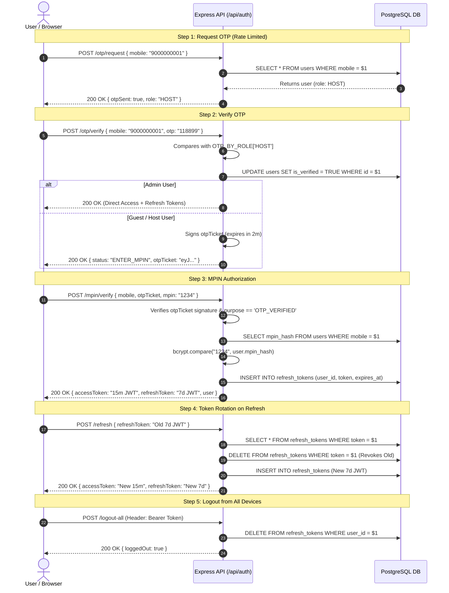
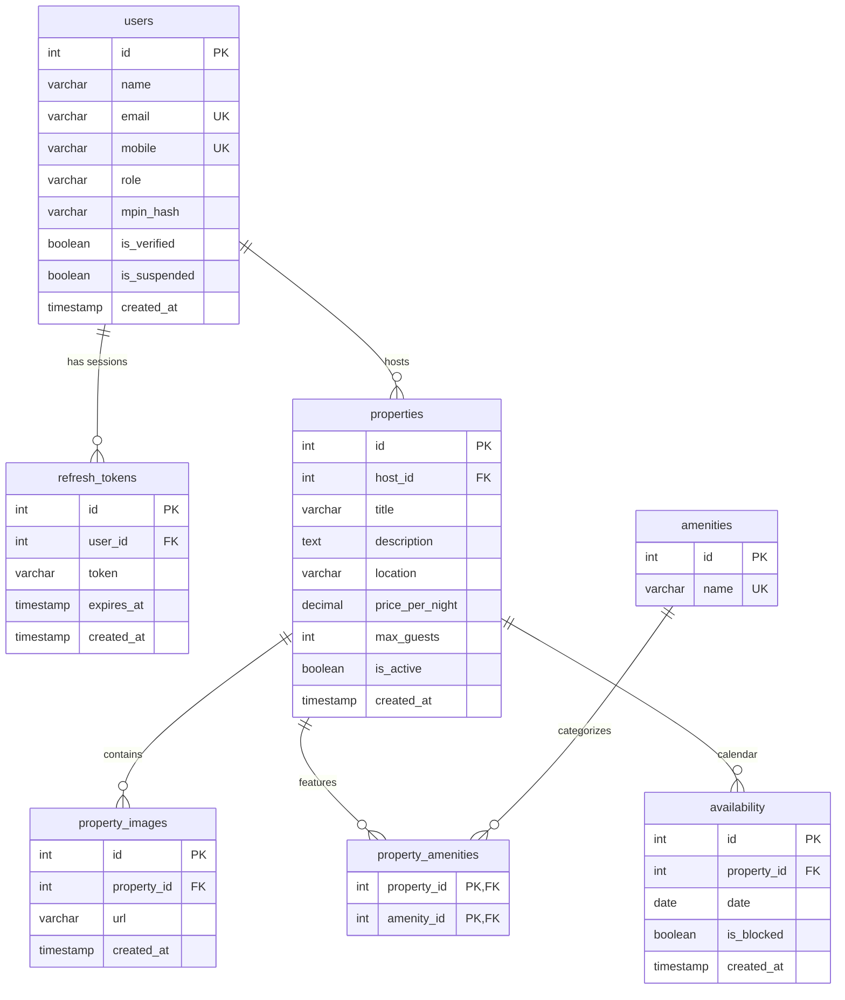

# Vistora — Complete System Architecture, Codebase Audit & Interview Reference

> **Document Name:** `ANSWER.md`  
> **Project Scope:** Full Codebase Audit of Vistora (Backend: `VistoraServer` | Frontend: `vistora-web`)  
> **Stack Overview:** Node.js, Express 5, PostgreSQL (`pg`), Zod, JWT, bcrypt, express-rate-limit on the backend; Vue 3, TypeScript, Pinia, TanStack Query (`@tanstack/vue-query`), Axios, Vuetify 3 on the frontend.  
> **Source-of-Truth Principle:** Grounded strictly in actual repository code. Unimplemented features are explicitly marked as **NOT DONE**.

---

# Table of Contents
1. [What is Done vs Not Done (Feature Checklist)](#1-what-is-done-vs-not-done)
2. [Architecture & 5-Layer Pattern](#2-architecture)
3. [Authentication & Session Flow (Step-by-Step)](#3-auth-flow)
4. [Role-Based Access Control (RBAC) & Security Enforcement](#4-rbac)
5. [Database Schema, Transactions & Advanced SQL](#5-database)
6. [Complete API Endpoints Specification](#6-all-api-endpoints)
7. [Frontend Architecture (Vue 3, Pinia, TanStack Query & Tab-Lock)](#7-frontend)
8. [Error Handling & Schema Validation](#8-error-handling-and-validation)
9. [20 Project-Specific Technical Interview Q&A](#9-interview-qa)
10. [Weak Points, Security Gaps & Interviewer Critique Defense](#10-weak-points)

---

# 1. WHAT IS DONE vs NOT DONE

Below is the verified checklist of all features across Vistora. Every item links to the physical code files where it lives, or is explicitly categorized as **NOT DONE**.

### 1.1 Authentication & Session Management
| Feature | Status | Primary File Paths | Notes / Implementation Details |
|---|---|---|---|
| User Registration (`POST /api/auth/register`) | **DONE** | [`src/modules/auth/auth.routes.js`](file:///O:/projects/VistoraServer/src/modules/auth/auth.routes.js#L20-L24), [`auth.controller.js`](file:///O:/projects/VistoraServer/src/modules/auth/auth.controller.js#L3-L14), [`auth.service.js`](file:///O:/projects/VistoraServer/src/modules/auth/auth.service.js#L65-L92), [`auth.repository.js`](file:///O:/projects/VistoraServer/src/modules/auth/auth.repository.js#L3-L14) | Creates `GUEST` or `HOST` with `is_verified = false`, `mpin_hash = null`. Duplicate mobile/email returns 409 Conflict. |
| OTP Dispatch (`POST /api/auth/otp/request`) | **DONE** | [`src/modules/auth/auth.routes.js`](file:///O:/projects/VistoraServer/src/modules/auth/auth.routes.js#L26-L31), [`auth.controller.js`](file:///O:/projects/VistoraServer/src/modules/auth/auth.controller.js#L16-L27), [`auth.service.js`](file:///O:/projects/VistoraServer/src/modules/auth/auth.service.js#L94-L119), [`src/utils/otp.constants.js`](file:///O:/projects/VistoraServer/src/utils/otp.constants.js#L1-L9) | Rate-limited (5 req/min). Validates user exists and is not suspended. Returns `{ otpSent: true, role }`. In dev, logs OTP to server console. |
| Real SMS / Email Delivery (Twilio / MSG91) | **NOT DONE** | *None* | Uses development-only fixed OTP map (`OTP_BY_ROLE`) in `src/utils/otp.constants.js`. |
| OTP Verification (`POST /api/auth/otp/verify`) | **DONE** | [`src/modules/auth/auth.routes.js`](file:///O:/projects/VistoraServer/src/modules/auth/auth.routes.js#L33-L38), [`auth.controller.js`](file:///O:/projects/VistoraServer/src/modules/auth/auth.controller.js#L29-L40), [`auth.service.js`](file:///O:/projects/VistoraServer/src/modules/auth/auth.service.js#L121-L175) | Rate-limited (5 req/min). Marks user `is_verified = true`. Admin receives session tokens directly. Guest/Host receives a 2-minute `otpTicket`. |
| 2-Minute Signed OTP Ticket | **DONE** | [`src/modules/auth/auth.service.js`](file:///O:/projects/VistoraServer/src/modules/auth/auth.service.js#L39-L63), [`auth.service.js`](file:///O:/projects/VistoraServer/src/modules/auth/auth.service.js#L158-L167) | JWT signed with `{ userId, mobile, role, purpose: 'OTP_VERIFIED' }`, expiring in 2 minutes. Gates MPIN set and verify endpoints. |
| Set Initial MPIN (`POST /api/auth/mpin/set`) | **DONE** | [`src/modules/auth/auth.routes.js`](file:///O:/projects/VistoraServer/src/modules/auth/auth.routes.js#L40-L44), [`auth.controller.js`](file:///O:/projects/VistoraServer/src/modules/auth/auth.controller.js#L42-L53), [`auth.service.js`](file:///O:/projects/VistoraServer/src/modules/auth/auth.service.js#L177-L204) | Verifies `otpTicket`, hashes 4-digit MPIN with `bcrypt` (10 rounds), saves `mpin_hash`, issues access + refresh tokens. |
| MPIN Login Verification (`POST /api/auth/mpin/verify`) | **DONE** | [`src/modules/auth/auth.routes.js`](file:///O:/projects/VistoraServer/src/modules/auth/auth.routes.js#L46-L51), [`auth.controller.js`](file:///O:/projects/VistoraServer/src/modules/auth/auth.controller.js#L55-L66), [`auth.service.js`](file:///O:/projects/VistoraServer/src/modules/auth/auth.service.js#L206-L239) | Rate-limited (5 req/min). Validates `otpTicket`, compares candidate MPIN with `bcrypt.compare`, issues access + refresh tokens. |
| Access Token (15-min JWT) | **DONE** | [`src/modules/auth/auth.service.js`](file:///O:/projects/VistoraServer/src/modules/auth/auth.service.js#L13-L22) | Signed with `{ userId, mobile, role }`, `expiresIn: '15m'`. Transmitted via `Authorization: Bearer <token>`. |
| Refresh Token Storage & Rotation | **DONE** | [`src/modules/auth/auth.service.js`](file:///O:/projects/VistoraServer/src/modules/auth/auth.service.js#L270-L300), [`auth.repository.js`](file:///O:/projects/VistoraServer/src/modules/auth/auth.repository.js#L62-L71) | Stored server-side in `refresh_tokens`. On every refresh, the old token is revoked/deleted and a new 7-day token is issued and stored. |
| Silent Session Refresh (`POST /api/auth/refresh`) | **DONE** | [`src/modules/auth/auth.routes.js`](file:///O:/projects/VistoraServer/src/modules/auth/auth.routes.js#L53-L57), [`auth.controller.js`](file:///O:/projects/VistoraServer/src/modules/auth/auth.controller.js#L68-L80), [`auth.service.js`](file:///O:/projects/VistoraServer/src/modules/auth/auth.service.js#L241-L300) | Validates token signature, token type (`REFRESH`), DB existence, and user suspension. Rotates refresh token and returns new access + refresh tokens. |
| Soft Tab-Lock Re-authorization (`POST /api/auth/mpin/unlock`) | **DONE** | [`src/modules/auth/auth.routes.js`](file:///O:/projects/VistoraServer/src/modules/auth/auth.routes.js#L59-L64), [`auth.controller.js`](file:///O:/projects/VistoraServer/src/modules/auth/auth.controller.js#L82-L96), [`auth.service.js`](file:///O:/projects/VistoraServer/src/modules/auth/auth.service.js#L302-L330) | Protected by `authMiddleware`. Verifies candidate MPIN against logged-in user hash without regenerating session tokens. |
| Single-Session Logout (`POST /api/auth/logout`) | **DONE** | [`src/modules/auth/auth.routes.js`](file:///O:/projects/VistoraServer/src/modules/auth/auth.routes.js#L66-L69), [`auth.controller.js`](file:///O:/projects/VistoraServer/src/modules/auth/auth.controller.js#L98-L113), [`auth.service.js`](file:///O:/projects/VistoraServer/src/modules/auth/auth.service.js#L332-L340) | Deletes the specific refresh token from `refresh_tokens` table. |
| Logout From All Sessions (`POST /api/auth/logout-all`) | **DONE** | [`src/modules/auth/auth.routes.js`](file:///O:/projects/VistoraServer/src/modules/auth/auth.routes.js#L71-L75), [`auth.controller.js`](file:///O:/projects/VistoraServer/src/modules/auth/auth.controller.js#L115-L126), [`auth.service.js`](file:///O:/projects/VistoraServer/src/modules/auth/auth.service.js#L342-L350), [`auth.repository.js`](file:///O:/projects/VistoraServer/src/modules/auth/auth.repository.js#L106-L113) | Protected by `authMiddleware`. Calls `deleteRefreshTokensByUserId(req.user.id)` to invalidate all active refresh tokens for the user. |
| In-Memory Rate Limiting | **DONE** | [`src/middleware/rateLimiter.middleware.js`](file:///O:/projects/VistoraServer/src/middleware/rateLimiter.middleware.js#L1-L15) | `express-rate-limit` enforces a maximum of 5 requests per minute per IP on `/otp/request`, `/otp/verify`, and `/mpin/verify`. |
| Real-time Suspended User Blocking | **DONE** | [`src/middleware/auth.middleware.js`](file:///O:/projects/VistoraServer/src/middleware/auth.middleware.js#L44-L48) | Every protected request executes `findUserById(decoded.userId)`; if `is_suspended === true`, immediately aborts with HTTP 403 Forbidden. |

---

### 1.2 Admin Moderation & RBAC
| Feature | Status | Primary File Paths | Notes / Implementation Details |
|---|---|---|---|
| Admin Account Seeding | **DONE** | [`src/db/seed.js`](file:///O:/projects/VistoraServer/src/db/seed.js#L9-L22) | Seeds `Vistora Admin` (`9000000000`, role `'ADMIN'`). Direct OTP `55555` login without MPIN. |
| RBAC Role Gate Middleware | **DONE** | [`src/middleware/role.middleware.js`](file:///O:/projects/VistoraServer/src/middleware/role.middleware.js#L1-L21) | `requireRole(['HOST'])` and `requireRole(['ADMIN'])` factories inspect `req.user.role`. |
| Admin Suspend / Unsuspend User (`PATCH /api/admin/users/:id/suspend`) | **DONE** | [`src/modules/admin/admin.routes.js`](file:///O:/projects/VistoraServer/src/modules/admin/admin.routes.js#L1-L28), [`admin.controller.js`](file:///O:/projects/VistoraServer/src/modules/admin/admin.controller.js#L1-L26), [`admin.service.js`](file:///O:/projects/VistoraServer/src/modules/admin/admin.service.js#L1-L40), [`admin.repository.js`](file:///O:/projects/VistoraServer/src/modules/admin/admin.repository.js#L1-L17), [`admin.validation.js`](file:///O:/projects/VistoraServer/src/modules/admin/admin.validation.js#L1-L13) | Protected by `authMiddleware` + `requireRole(['ADMIN'])`. Validates `:id` and `{ is_suspended: boolean }`. Blocks self-suspension, non-existent users, and admin suspension. Revokes all refresh tokens when suspending. |
| Admin Property Moderation / Deactivation API | **NOT DONE** | *None* | No dedicated admin listing deactivation endpoint implemented yet. |
| Audit Logging Engine | **NOT DONE** | *None* | Outlined in PRD, but table and service not implemented. |

---

### 1.3 Properties & Listings
| Feature | Status | Primary File Paths | Notes / Implementation Details |
|---|---|---|---|
| Browse Active Properties (`GET /api/properties`) | **DONE** | [`src/modules/properties/property.routes.js`](file:///O:/projects/VistoraServer/src/modules/properties/property.routes.js#L16-L19), [`property.controller.js`](file:///O:/projects/VistoraServer/src/modules/properties/property.controller.js#L63-L75), [`property.repository.js`](file:///O:/projects/VistoraServer/src/modules/properties/property.repository.js#L146-L178) | Public route. Returns active listings with aggregated images, ordered by `created_at DESC`. Safe pagination parameters (`limit`, `offset`). |
| Get Single Property (`GET /api/properties/:id`) | **DONE** | [`src/modules/properties/property.routes.js`](file:///O:/projects/VistoraServer/src/modules/properties/property.routes.js#L56-L59), [`property.controller.js`](file:///O:/projects/VistoraServer/src/modules/properties/property.controller.js#L26-L43), [`property.repository.js`](file:///O:/projects/VistoraServer/src/modules/properties/property.repository.js#L90-L118) | Public route. Joins host contact info (`users`), images (`property_images`), and amenities (`amenities`) using `JSON_AGG(DISTINCT ...)`. |
| Host Create Property (`POST /api/properties`) | **DONE** | [`src/modules/properties/property.routes.js`](file:///O:/projects/VistoraServer/src/modules/properties/property.routes.js#L27-L33), [`property.controller.js`](file:///O:/projects/VistoraServer/src/modules/properties/property.controller.js#L5-L24), [`property.repository.js`](file:///O:/projects/VistoraServer/src/modules/properties/property.repository.js#L4-L85) | Protected by `authMiddleware` + `requireRole(['HOST'])` + Zod schema. Executes multi-table atomic PostgreSQL transaction (`BEGIN ... COMMIT`). |
| Host View Own Listings (`GET /api/properties/my-properties`) | **DONE** | [`src/modules/properties/property.routes.js`](file:///O:/projects/VistoraServer/src/modules/properties/property.routes.js#L35-L49), [`property.controller.js`](file:///O:/projects/VistoraServer/src/modules/properties/property.controller.js#L45-L61), [`property.repository.js`](file:///O:/projects/VistoraServer/src/modules/properties/property.repository.js#L123-L141) | Protected for `HOST`. Fetches properties where `host_id = req.user.id` with aggregated images. |
| Property Update / Edit (`PUT/PATCH /api/properties/:id`) | **NOT DONE** | *None* | Neither route, controller, nor repository method exists. |
| Property Delete (`DELETE /api/properties/:id`) | **NOT DONE** | *None* | Neither route, controller, nor repository method exists. |
| Property Dynamic Search & Filters (City, Price, Guests) | **NOT DONE** | [`src/modules/properties/property.repository.js`](file:///O:/projects/VistoraServer/src/modules/properties/property.repository.js#L146-L178) | `findAllActiveProperties` supports limit/offset pagination, but lacks query parameter filters (`location ILIKE`, price range, guest count). |

---

### 1.4 Media & Images
| Feature | Status | Primary File Paths | Notes / Implementation Details |
|---|---|---|---|
| Image Relational Database Storage | **DONE** | [`src/db/migrate_properties.js`](file:///O:/projects/VistoraServer/src/db/migrate_properties.js#L21-L26) | `property_images` table with foreign key `property_id REFERENCES properties(id) ON DELETE CASCADE`. |
| Bulk Image Insertion via Array | **DONE** | [`src/modules/properties/property.repository.js`](file:///O:/projects/VistoraServer/src/modules/properties/property.repository.js#L34-L46) | Inserts image URLs in a single SQL query using `UNNEST($2::text[]) RETURNING id, url`. |
| Direct Cloud File Upload (Multer / AWS S3) | **NOT DONE** | *None* | Accepts pre-existing image URL strings in JSON payloads. No multipart form upload or presigned S3 pipeline is implemented. |

---

### 1.5 Amenities
| Feature | Status | Primary File Paths | Notes / Implementation Details |
|---|---|---|---|
| Master Amenities Table & Starter Seed | **DONE** | [`src/db/migrate_properties.js`](file:///O:/projects/VistoraServer/src/db/migrate_properties.js#L29-L32), [`src/db/migrate_properties.js`](file:///O:/projects/VistoraServer/src/db/migrate_properties.js#L54-L63) | Table `amenities` with unique `name`. Seeded with 8 amenities (WiFi, Air Conditioning, Pool, Parking, Kitchen, TV, Workspace, Washing Machine). |
| Many-to-Many Junction Table | **DONE** | [`src/db/migrate_properties.js`](file:///O:/projects/VistoraServer/src/db/migrate_properties.js#L35-L39) | `property_amenities` table with composite primary key `(property_id, amenity_id)` and cascade foreign keys. |
| Transactional Junction Bulk Insert | **DONE** | [`src/modules/properties/property.repository.js`](file:///O:/projects/VistoraServer/src/modules/properties/property.repository.js#L48-L70) | Inserted via CTE: `WITH inserted AS (INSERT INTO property_amenities ... ON CONFLICT DO NOTHING) SELECT a.id, a.name ...`. |
| Public Amenities Query Endpoint (`GET /api/amenities`) | **NOT DONE** | *None* | No controller or route exists to query the master list of amenities dynamically. |

---

### 1.6 Availability & Calendar
| Feature | Status | Primary File Paths | Notes / Implementation Details |
|---|---|---|---|
| Availability Database Table & Constraints | **DONE** | [`src/db/migrate_properties.js`](file:///O:/projects/VistoraServer/src/db/migrate_properties.js#L42-L51) | Table `availability` created with `property_id`, `date`, `is_blocked`, unique constraint `unique_property_date (property_id, date)`, and index `idx_availability_property_date`. |
| Availability Query & Calendar Blocking APIs | **NOT DONE** | *None* | No endpoints exist to view property calendar dates, block dates, or check date availability. |

---

### 1.7 Bookings, Payments, Reviews, Chat & Notifications
| Feature | Status | Primary File Paths | Notes / Implementation Details |
|---|---|---|---|
| Bookings Module | **NOT DONE** | *None* | Described in PRD, but no table migrations, routes, or controllers exist. |
| Razorpay Payments Module | **NOT DONE** | *None* | No tables, SDK integration, or endpoints exist. |
| Real-Time Chat (Socket.IO) | **NOT DONE** | *None* | Socket.IO dependency is absent from `package.json`. No chat tables exist. |
| Reviews & Ratings | **NOT DONE** | *None* | No tables or endpoints exist. |
| Notifications Engine | **NOT DONE** | *None* | No tables or endpoints exist. |

---

### 1.8 Frontend Implementation (`vistora-web`)
| Feature | Status | Primary File Paths | Notes / Implementation Details |
|---|---|---|---|
| Vue 3 + TypeScript + Vuetify + Pinia Setup | **DONE** | [`vistora-web/src/main.ts`](file:///O:/projects/vistora-web/src/main.ts#L1-L18), [`App.vue`](file:///O:/projects/vistora-web/src/App.vue#L1-L31) | Complete scaffolding with VueQueryPlugin, Vuetify 3 modern styling, Pinia store, and Vue Router. |
| Registration View (`/register`) | **DONE** | [`vistora-web/src/views/RegisterView.vue`](file:///O:/projects/vistora-web/src/views/RegisterView.vue#L1-L150) | Collects Name, Email, Mobile, and includes role selection between Guest and Host. |
| Two-Step Login View (`/login`) | **DONE** | [`vistora-web/src/views/LoginView.vue`](file:///O:/projects/vistora-web/src/views/LoginView.vue#L1-L145) | Step 1: Mobile input triggers OTP request. Step 2: 6-digit PIN input with resend and edit options. |
| Set MPIN Screen (`/set-mpin`) | **DONE** | [`vistora-web/src/views/SetMpinView.vue`](file:///O:/projects/vistora-web/src/views/SetMpinView.vue#L1-L94) | Dual PIN input (Create + Confirm PIN). Protected by temporary state guard. |
| Enter MPIN Screen (`/enter-mpin`) | **DONE** | [`vistora-web/src/views/EnterMpinView.vue`](file:///O:/projects/vistora-web/src/views/EnterMpinView.vue#L1-L98) | Single 4-digit PIN entry for returning logins. |
| Guest Dashboard (`/dashboard`) | **DONE** | [`vistora-web/src/views/DashboardView.vue`](file:///O:/projects/vistora-web/src/views/DashboardView.vue#L1-L59) | UI dashboard displaying user session metrics (Role, Mobile, Security Layer, Session TTL). |
| Host Management Console (`/host`) | **PARTIAL** | [`vistora-web/src/views/HostView.vue`](file:///O:/projects/vistora-web/src/views/HostView.vue#L1-L65) | Shell view with placeholder metrics and listing placeholder card. **Property creation form & listing fetch are NOT DONE in UI**. |
| Admin Control Center (`/admin`) | **PARTIAL** | [`vistora-web/src/views/AdminView.vue`](file:///O:/projects/vistora-web/src/views/AdminView.vue#L1-L65) | Shell view with system status metrics. **User suspension tables & listing moderation controls are NOT DONE in UI**. |
| Pinia Auth Store (`useAuthStore`) | **DONE** | [`vistora-web/src/stores/auth.store.ts`](file:///O:/projects/vistora-web/src/stores/auth.store.ts#L1-L97) | Centralizes reactive auth state, token persistence, and in-memory tab-lock state. |
| TanStack Query Auth Mutations | **DONE** | [`vistora-web/src/composables/useAuthMutations.ts`](file:///O:/projects/vistora-web/src/composables/useAuthMutations.ts#L1-L175) | Encapsulates register, request OTP, verify OTP, set MPIN, verify MPIN, unlock MPIN, logout, and **logoutAll** mutations. |
| Axios Interceptor with Silent Refresh & Queue | **DONE** | [`vistora-web/src/api/client.ts`](file:///O:/projects/vistora-web/src/api/client.ts#L1-L97) | Injects Bearer token; handles 401 errors, enqueues concurrent requests, refreshes and rotates tokens, saving both access and refresh tokens to localStorage. |
| MPIN Screen Tab-Lock (Page Visibility API) | **DONE** | [`vistora-web/src/composables/useTabLock.ts`](file:///O:/projects/vistora-web/src/composables/useTabLock.ts#L1-L25), [`TabLockModal.vue`](file:///O:/projects/vistora-web/src/components/TabLockModal.vue#L1-L107) | Detects browser tab focus shifts and displays a modal requiring MPIN to unlock UI without terminating tokens. |
| Logout From All Devices Button | **DONE** | [`vistora-web/src/components/Navbar.vue`](file:///O:/projects/vistora-web/src/components/Navbar.vue#L48-L60) | Positioned in navigation bar next to regular logout, invoking `logoutAllMutation`. |
| Frontend Property Catalog & Booking UI | **NOT DONE** | *None* | Guest browsing catalog and stay reservation flow are not built in Vue. |

---

# 2. ARCHITECTURE

Vistora adopts a modular 5-tier layered architecture on the backend, ensuring a strict unidirectional flow of dependencies and clean separation of concerns.

```
                           ┌────────────────────────┐
                           │   HTTP Client (Axios)  │
                           └───────────┬────────────┘
                                       │ HTTP Request
                                       ▼
                           ┌────────────────────────┐
                           │  Express Route Layer   │  <-- auth.routes, property.routes, admin.routes
                           └───────────┬────────────┘
                                       │ (req, res, next)
                                       ▼
                           ┌────────────────────────┐
                           │ Validation Middleware  │  <-- validate.middleware + Zod schemas
                           └───────────┬────────────┘
                                       │ Validated req.body
                                       ▼
                           ┌────────────────────────┐
                           │    Controller Layer    │  <-- auth.controller, property.controller, admin.controller
                           └───────────┬────────────┘
                                       │ Extracted DTOs
                                       ▼
                           ┌────────────────────────┐
                           │     Service Layer      │  <-- auth.service, property.service, admin.service
                           └───────────┬────────────┘
                                       │ Domain calls & business logic
                                       ▼
                           ┌────────────────────────┐
                           │    Repository Layer    │  <-- auth.repository, property.repository, admin.repository
                           └───────────┬────────────┘
                                       │ Parameterized SQL ($1, $2)
                                       ▼
                           ┌────────────────────────┐
                           │  PostgreSQL Database   │  <-- pg.Pool (Aiven Cloud)
                           └────────────────────────┘
```

### 2.1 Backend Folder Structure (`O:\projects\VistoraServer`)
```
VistoraServer/
├── docs/                               # PRD, integration guides, testing procedures
├── src/
│   ├── app.js                          # Express assembly, CORS, cookie-parser, route mounting
│   ├── index.js                        # Entrypoint requiring server.js
│   ├── server.js                       # HTTP server lifecycle, DB connection ping, ASCII banner
│   ├── config/
│   │   ├── db.js                       # PostgreSQL pg.Pool initialization with SSL handling
│   │   └── aiven-ca.pem                # Optional CA certificate for cloud DB connection
│   ├── db/
│   │   ├── migrate_properties.js       # SQL DDL script for properties, images, amenities, availability
│   │   └── seed.js                     # Seed script for Admin, Demo Host, Demo Guest accounts
│   ├── middleware/
│   │   ├── auth.middleware.js          # JWT Bearer verification & user suspension gate
│   │   ├── error.middleware.js         # Centralized HTTP error handler
│   │   ├── rateLimiter.middleware.js   # In-memory IP rate limiter for auth routes
│   │   ├── role.middleware.js          # RBAC requireRole() factory
│   │   └── validate.middleware.js      # Zod request validation middleware
│   ├── modules/
│   │   ├── admin/                      # Admin Moderation Module
│   │   │   ├── admin.controller.js     # Request/response adapter for admin actions
│   │   │   ├── admin.repository.js     # Raw SQL updates for user suspension
│   │   │   ├── admin.routes.js         # PATCH /users/:id/suspend with guards
│   │   │   ├── admin.service.js        # Self-suspension checks, role rules, session revocation
│   │   │   ├── admin.validation.js     # Zod schema for suspension flag
│   │   │   └── index.js                # Exports router
│   │   ├── auth/                       # Authentication Module
│   │   │   ├── auth.controller.js      # Request/response handling for OTP, MPIN, tokens, logout
│   │   │   ├── auth.repository.js      # Raw SQL queries for users & refresh_tokens
│   │   │   ├── auth.routes.js          # Chained route definitions & rate limiters
│   │   │   ├── auth.service.js         # OTP checks, bcrypt hashing, JWT issuance & rotation
│   │   │   ├── auth.validation.js      # Zod schemas for auth endpoints
│   │   │   └── index.js                # Exports router
│   │   └── properties/                 # Properties Module
│   │       ├── property.controller.js  # Request/response handling
│   │       ├── property.repository.js  # Raw SQL with transactions & JSON_AGG
│   │       ├── property.routes.js      # Endpoint definitions
│   │       ├── property.service.js     # Property creation and listing logic
│   │       ├── property.validation.js  # Zod schemas for property listing
│   │       └── index.js                # Exports router
│   ├── utils/
│   │   ├── appError.js                 # Custom operational AppError class
│   │   ├── banner.js                   # Terminal visual output banner
│   │   └── otp.constants.js            # Hardcoded role OTP map
│   └── validators/
│       └── common.validation.js        # Shared Zod schemas (mobile, OTP, MPIN)
├── .env                                # Environment variables (PORT, DB credentials, JWT_SECRET)
└── package.json                        # CommonJS module manifest
```

### 2.2 The 5 Backend Architectural Layers

1. **Route Layer (`*.routes.js`)**:
   - Declares URL patterns and HTTP verbs.
   - Chains middleware in strict order: Rate Limiter $\to$ Authentication $\to$ Role Authorization $\to$ Input Validation $\to$ Controller.
2. **Validation Layer (`*.validation.js` + `validate.middleware.js`)**:
   - Employs **Zod** to validate incoming `req.body` and route params before controllers run.
   - Enforces `.strict()` to reject unauthorized properties. Returns HTTP 400 with formatted error arrays.
3. **Controller Layer (`*.controller.js`)**:
   - HTTP adapter. Reads parameters from `req.body`, `req.params`, `req.query`, and `req.user`.
   - Delegates business execution to the Service Layer.
   - Returns standard HTTP status codes (`200 OK`, `201 Created`). Forwards unexpected errors to `next(error)`.
4. **Service Layer (`*.service.js`)**:
   - Contains pure business logic. Never interacts directly with Express `req` or `res`.
   - Manages cryptography, validation of domain invariants, and token lifecycle.
   - Throws operational `AppError` instances with explicit HTTP status codes (`400`, `401`, `403`, `404`, `409`).
5. **Repository Layer (`*.repository.js`)**:
   - Direct database access layer executing raw SQL queries via PostgreSQL `pg.Pool`.
   - Uses parameterized queries (`$1, $2`) exclusively.
   - Manages database transactions (`BEGIN`, `COMMIT`, `ROLLBACK`) and aggregations (`JSON_AGG`).

---

### 2.3 End-to-End Request Lifecycle Example: `POST /api/properties`

1. **Client Request**:
   Host client sends `POST http://localhost:5000/api/properties` with header `Authorization: Bearer <HOST_JWT>` and JSON payload.
2. **Route Match & Middleware Chain** ([`property.routes.js`](file:///O:/projects/VistoraServer/src/modules/properties/property.routes.js#L27-L33)):
   Routes through `authMiddleware` $\to$ `requireRole(['HOST'])` $\to$ `validate(createPropertySchema)` $\to$ `propertyController.createProperty`.
3. **Auth Middleware** ([`auth.middleware.js`](file:///O:/projects/VistoraServer/src/middleware/auth.middleware.js#L4-L62)):
   Decodes JWT, executes `findUserById(decoded.userId)`, confirms `user.is_suspended === false`, and attaches user info to `req.user`.
4. **Role Middleware** ([`role.middleware.js`](file:///O:/projects/VistoraServer/src/middleware/role.middleware.js#L1-L17)):
   Verifies `req.user.role === 'HOST'`.
5. **Validation Middleware** ([`validate.middleware.js`](file:///O:/projects/VistoraServer/src/middleware/validate.middleware.js#L1-L18)):
   Executes `createPropertySchema.safeParse(req.body)`. Sanitizes `req.body`.
6. **Controller** ([`property.controller.js`](file:///O:/projects/VistoraServer/src/modules/properties/property.controller.js#L5-L24)):
   Invokes `propertyService.createProperty(req.user.id, req.body)`.
7. **Service** ([`property.service.js`](file:///O:/projects/VistoraServer/src/modules/properties/property.service.js#L5-L35)):
   Sanitizes fields and forwards to `propertyRepository.createPropertyWithDetails()`.
8. **Repository Transaction** ([`property.repository.js`](file:///O:/projects/VistoraServer/src/modules/properties/property.repository.js#L4-L85)):
   Checks out client, runs `BEGIN`, inserts property record, bulk-inserts images via `UNNEST($2::text[])`, bulk-inserts amenities via CTE, executes `COMMIT`, releases client.
9. **Response**: Controller sends HTTP `201 Created` with full property, image, and amenity data.

---

# 3. AUTH FLOW

Vistora implements a **passwordless OTP + MPIN architecture** with mobile numbers as unique identities.



### 3.1 Step 1: OTP Request
- **Endpoint:** `POST /api/auth/otp/request`
- **Rate Limit:** 5 requests / min per IP via `authRateLimiter`.
- **Controller & Service:** [`auth.controller.js:requestOtp`](file:///O:/projects/VistoraServer/src/modules/auth/auth.controller.js#L16-L27) $\to$ [`auth.service.js:requestOtp`](file:///O:/projects/VistoraServer/src/modules/auth/auth.service.js#L94-L119)
- **Flow:**
  1. Validates mobile number format (`/^\d{10,15}$/`).
  2. Database lookup: `SELECT * FROM users WHERE mobile = $1`.
  3. Returns 404 if user not found; returns 403 if `user.is_suspended === true`.
  4. Retrieves expected OTP from `OTP_BY_ROLE` mapping in [`src/utils/otp.constants.js`](file:///O:/projects/VistoraServer/src/utils/otp.constants.js#L1-L9).
  5. In development, logs OTP to terminal. Returns `{ otpSent: true, role: user.role }`.

### 3.2 Step 2: OTP Verification & Signed Ticket
- **Endpoint:** `POST /api/auth/otp/verify`
- **Rate Limit:** 5 requests / min per IP.
- **Controller & Service:** [`auth.controller.js:verifyOtp`](file:///O:/projects/VistoraServer/src/modules/auth/auth.controller.js#L29-L40) $\to$ [`auth.service.js:verifyOtp`](file:///O:/projects/VistoraServer/src/modules/auth/auth.service.js#L121-L175)
- **Flow:**
  1. Validates OTP against role constant (`GUEST: '999999'`, `HOST: '118899'`, `ADMIN: '55555'`).
  2. Sets `user.is_verified = true` in PostgreSQL.
  3. **Admin Branch**: Skips MPIN entirely, returning full session tokens immediately.
  4. **Guest/Host Branch**: Issues a 2-minute signed `otpTicket` JWT:
     ```javascript
     const otpTicket = jwt.sign(
       { userId: user.id, mobile: user.mobile, role: user.role, purpose: 'OTP_VERIFIED' },
       process.env.JWT_SECRET,
       { expiresIn: '2m' }
     );
     ```
  5. Returns status `'SET_MPIN_REQUIRED'` or `'ENTER_MPIN'` with `otpTicket`.

### 3.3 Step 3: MPIN Setup (First-Time Login)
- **Endpoint:** `POST /api/auth/mpin/set`
- **Controller & Service:** [`auth.controller.js:setMpin`](file:///O:/projects/VistoraServer/src/modules/auth/auth.controller.js#L42-L53) $\to$ [`auth.service.js:setMpin`](file:///O:/projects/VistoraServer/src/modules/auth/auth.service.js#L177-L204)
- **Flow:**
  1. Verifies `otpTicket` signature and claims (`purpose === 'OTP_VERIFIED'`).
  2. Hashes 4-digit MPIN using `bcrypt.hash(mpin, 10)`.
  3. Stores hash in `users.mpin_hash` and issues session tokens.

### 3.4 Step 4: MPIN Verification (Returning Login)
- **Endpoint:** `POST /api/auth/mpin/verify`
- **Rate Limit:** 5 requests / min per IP.
- **Controller & Service:** [`auth.controller.js:verifyMpin`](file:///O:/projects/VistoraServer/src/modules/auth/auth.controller.js#L55-L66) $\to$ [`auth.service.js:verifyMpin`](file:///O:/projects/VistoraServer/src/modules/auth/auth.service.js#L206-L239)
- **Flow:**
  1. Verifies `otpTicket`.
  2. Compares MPIN with `bcrypt.compare(mpin, user.mpin_hash)`.
  3. Issues session tokens.

### 3.5 Step 5: Token Generation & Server Storage
- **Access Token:** 15-minute JWT signed with `{ userId, mobile, role }`.
- **Refresh Token:** 7-day JWT stored in PostgreSQL `refresh_tokens` table with `expires_at` timestamp.

### 3.6 Step 6: Silent Token Refresh With Rotation
- **Endpoint:** `POST /api/auth/refresh`
- **Controller & Service:** [`auth.controller.js:refreshToken`](file:///O:/projects/VistoraServer/src/modules/auth/auth.controller.js#L68-L80) $\to$ [`auth.service.js:refreshAccessToken`](file:///O:/projects/VistoraServer/src/modules/auth/auth.service.js#L241-L300)
- **Rotation Flow:**
  1. Validates incoming refresh token signature, claim `type === 'REFRESH'`, and DB existence.
  2. **Revokes Old Token:** Deletes old token from `refresh_tokens`:
     ```javascript
     await authRepository.deleteRefreshToken(refreshToken);
     ```
  3. **Issues New Rotated Refresh Token:** Signs a new 7-day refresh token and inserts it into PostgreSQL:
     ```javascript
     const newRefreshToken = jwt.sign({ userId: user.id, type: 'REFRESH' }, process.env.JWT_SECRET, { expiresIn: '7d' });
     await authRepository.createRefreshToken(user.id, newRefreshToken, expiresAt);
     ```
  4. Generates new 15-minute access token.
  5. Returns `{ accessToken, refreshToken: newRefreshToken }`.
  6. Frontend Axios interceptor updates `localStorage` with both tokens and drains queued requests.

### 3.7 Step 7: Soft Tab-Lock Re-authorization
- **Endpoint:** `POST /api/auth/mpin/unlock`
- **Controller & Service:** [`auth.controller.js:unlockMpin`](file:///O:/projects/VistoraServer/src/modules/auth/auth.controller.js#L82-L96) $\to$ [`auth.service.js:unlockMpin`](file:///O:/projects/VistoraServer/src/modules/auth/auth.service.js#L302-L330)
- Requires active `accessToken`. Compares MPIN with `bcrypt.compare`. Returns `{ unlocked: true }` without touching tokens.

### 3.8 Step 8: Single Logout vs Logout From All Sessions
- **Single-Session Logout (`POST /api/auth/logout`)**:
  - Deletes the specific refresh token passed in the request:
    ```sql
    DELETE FROM refresh_tokens WHERE token = $1;
    ```
- **Logout From All Sessions (`POST /api/auth/logout-all`)**:
  - Protected by `authMiddleware` (reads `req.user.id`).
  - Calls [`authRepository.deleteRefreshTokensByUserId(req.user.id)`](file:///O:/projects/VistoraServer/src/modules/auth/auth.repository.js#L106-L113):
    ```sql
    DELETE FROM refresh_tokens WHERE user_id = $1;
    ```
  - Deletes every active refresh token for that user across all devices.
  - Returns `200 OK` `{ message: "Logged out from all sessions", loggedOut: true }`.
  - Frontend triggers `clearSession()` and redirects to `/login`.

---

# 4. RBAC

Vistora enforces **Role-Based Access Control** across `GUEST`, `HOST`, and `ADMIN`.

### 4.1 Permission Matrix
| Capability | Guest | Host | Admin | Enforcement Mechanism |
|---|:---:|:---:|:---:|---|
| Self-Registration | ✅ | ✅ | ❌ | Validated in `auth.service.js:registerUser` (`['GUEST', 'HOST']` only) |
| OTP Login | ✅ | ✅ | ✅ | Public endpoint `POST /api/auth/otp/request` |
| MPIN Setup / Verification | ✅ | ✅ | ❌ | Admin bypasses MPIN directly to tokens |
| Browse Properties (Public) | ✅ | ✅ | ✅ | Public endpoint `GET /api/properties` |
| View Property Details | ✅ | ✅ | ✅ | Public endpoint `GET /api/properties/:id` |
| Create Property Listing | ❌ | ✅ | ❌ | `requireRole(['HOST'])` middleware |
| View Host My-Properties | ❌ | ✅ | ❌ | `requireRole(['HOST'])` middleware |
| Suspend/Unsuspend Users | ❌ | ❌ | ✅ | `requireRole(['ADMIN'])` on `PATCH /api/admin/users/:id/suspend` |
| Seeded Account | ❌ | ❌ | ✅ | Seeded via `src/db/seed.js` with direct OTP `55555` |

### 4.2 Middleware Role Enforcement
Enforced by [`src/middleware/role.middleware.js`](file:///O:/projects/VistoraServer/src/middleware/role.middleware.js#L1-L21):
```javascript
function requireRole(allowedRoles = []) {
  return (req, res, next) => {
    if (!req?.user) {
      return res.status(401).json({ message: 'Authentication required' });
    }
    if (!allowedRoles?.includes?.(req?.user?.role)) {
      return res.status(403).json({
        message: `Forbidden: Access restricted to [${(allowedRoles ?? []).join(', ')}]`,
      });
    }
    next();
  };
}
```

### 4.3 Admin User Suspension Logic
Admin user suspension is implemented in [`src/modules/admin/admin.service.js`](file:///O:/projects/VistoraServer/src/modules/admin/admin.service.js#L5-L40):
1. **Self-Suspension Guard:** `if (adminUserId === targetUserId) throw createAppError('Admins cannot suspend their own account', 400);`
2. **User Existence:** Returns 404 if user doesn't exist.
3. **Admin Immunity:** `if (targetUser.role === 'ADMIN') throw createAppError('Cannot suspend an administrator account', 403);`
4. **Immediate Session Revocation:** When `is_suspended === true`, calls `authRepository.deleteRefreshTokensByUserId(targetUserId)` to delete all refresh tokens immediately.
5. On the very next request, `authMiddleware` checks `user.is_suspended` and returns `403 Forbidden`, blocking access immediately.

---

# 5. DATABASE

### 5.1 Tables, Schema, Keys & Indexes



1. **`users` Table:**
   - Columns: `id SERIAL PRIMARY KEY`, `name VARCHAR(100) NOT NULL`, `email VARCHAR(150) UNIQUE NOT NULL`, `mobile VARCHAR(15) UNIQUE NOT NULL`, `role VARCHAR(20) DEFAULT 'GUEST'`, `mpin_hash VARCHAR(255) NULL`, `is_verified BOOLEAN DEFAULT FALSE`, `is_suspended BOOLEAN DEFAULT FALSE`, `created_at TIMESTAMP WITH TIME ZONE DEFAULT CURRENT_TIMESTAMP`.
2. **`refresh_tokens` Table:**
   - Columns: `id SERIAL PRIMARY KEY`, `user_id INT NOT NULL REFERENCES users(id) ON DELETE CASCADE`, `token VARCHAR(500) NOT NULL`, `expires_at TIMESTAMP WITH TIME ZONE NOT NULL`, `created_at TIMESTAMP WITH TIME ZONE DEFAULT CURRENT_TIMESTAMP`.
3. **`properties` Table:**
   - Columns: `id SERIAL PRIMARY KEY`, `host_id INT NOT NULL REFERENCES users(id) ON DELETE CASCADE`, `title VARCHAR(150) NOT NULL`, `description TEXT`, `location VARCHAR(150) NOT NULL`, `price_per_night DECIMAL(10, 2) NOT NULL`, `max_guests INT NOT NULL`, `is_active BOOLEAN DEFAULT TRUE`, `created_at TIMESTAMP WITH TIME ZONE DEFAULT CURRENT_TIMESTAMP`.
   - Indexes: `idx_properties_location ON properties(location)`, `idx_properties_host_id ON properties(host_id)`.
4. **`property_images` Table:**
   - Columns: `id SERIAL PRIMARY KEY`, `property_id INT NOT NULL REFERENCES properties(id) ON DELETE CASCADE`, `url VARCHAR(500) NOT NULL`, `created_at TIMESTAMP WITH TIME ZONE DEFAULT CURRENT_TIMESTAMP`.
5. **`amenities` Table:**
   - Columns: `id SERIAL PRIMARY KEY`, `name VARCHAR(50) NOT NULL UNIQUE`. Seeded with 8 amenities.
6. **`property_amenities` Table:**
   - Columns: `property_id INT NOT NULL REFERENCES properties(id) ON DELETE CASCADE`, `amenity_id INT NOT NULL REFERENCES amenities(id) ON DELETE CASCADE`.
   - Primary Key: Composite `PRIMARY KEY (property_id, amenity_id)`.
7. **`availability` Table:**
   - Columns: `id SERIAL PRIMARY KEY`, `property_id INT NOT NULL REFERENCES properties(id) ON DELETE CASCADE`, `date DATE NOT NULL`, `is_blocked BOOLEAN DEFAULT FALSE`, `created_at TIMESTAMP WITH TIME ZONE DEFAULT CURRENT_TIMESTAMP`.
   - Constraints & Indexes: `CONSTRAINT unique_property_date UNIQUE (property_id, date)`, `idx_availability_property_date ON availability(property_id, date)`.

---

### 5.2 Where Transactions Are Used (With Actual SQL)
In [`src/modules/properties/property.repository.js:createPropertyWithDetails`](file:///O:/projects/VistoraServer/src/modules/properties/property.repository.js#L4-L85):
```javascript
const client = await pool.connect();
try {
  await client.query('BEGIN');

  // Insert Property
  const propertyRes = await client.query(
    `INSERT INTO properties (host_id, title, description, location, price_per_night, max_guests)
     VALUES ($1, $2, $3, $4, $5, $6) RETURNING *;`,
    propertyValues
  );
  const propertyId = propertyRes.rows[0].id;

  // Bulk Insert Images via UNNEST
  if (cleanImages.length > 0) {
    await client.query(
      `INSERT INTO property_images (property_id, url)
       SELECT $1, UNNEST($2::text[]) RETURNING id, url;`,
      [propertyId, cleanImages]
    );
  }

  // Bulk Insert Amenities via CTE
  if (cleanAmenityIds.length > 0) {
    await client.query(
      `WITH inserted AS (
         INSERT INTO property_amenities (property_id, amenity_id)
         SELECT $1, UNNEST($2::int[])
         ON CONFLICT (property_id, amenity_id) DO NOTHING
       )
       SELECT a.id, a.name FROM amenities a
       INNER JOIN property_amenities pa ON pa.amenity_id = a.id
       WHERE pa.property_id = $1 ORDER BY a.name ASC;`,
      [propertyId, cleanAmenityIds]
    );
  }

  await client.query('COMMIT');
} catch (error) {
  await client.query('ROLLBACK');
  throw error;
} finally {
  client.release();
}
```

---

### 5.3 Where `JSON_AGG` Is Used & The Cartesian Product Problem
In [`src/modules/properties/property.repository.js:findPropertyById`](file:///O:/projects/VistoraServer/src/modules/properties/property.repository.js#L90-L118):
```sql
SELECT
  p.*,
  u.name AS host_name,
  u.email AS host_email,
  u.mobile AS host_mobile,
  COALESCE(
    JSON_AGG(DISTINCT JSONB_BUILD_OBJECT('id', pi.id, 'url', pi.url))
    FILTER (WHERE pi.id IS NOT NULL),
    '[]'
  ) AS images,
  COALESCE(
    JSON_AGG(DISTINCT JSONB_BUILD_OBJECT('id', a.id, 'name', a.name))
    FILTER (WHERE a.id IS NOT NULL),
    '[]'
  ) AS amenities
FROM properties p
JOIN users u ON p.host_id = u.id
LEFT JOIN property_images pi ON p.id = pi.property_id
LEFT JOIN property_amenities pa ON p.id = pa.property_id
LEFT JOIN amenities a ON pa.amenity_id = a.id
WHERE p.id = $1
GROUP BY p.id, u.id;
```
**Why `DISTINCT` is critical:** Joining `property_images` (M rows) and `property_amenities` (N rows) produces a Cartesian product ($M \times N$ rows). Without `DISTINCT`, `JSON_AGG` would duplicate images N times and amenities M times. `DISTINCT` eliminates duplicate rows before aggregation.

---

# 6. ALL API ENDPOINTS

| Method | Endpoint Path | Auth Required | Role Required | Request Body / Query Params | Response Status & Key Body Fields | Status |
|---|---|:---:|:---:|---|---|:---:|
| `GET` | `/health` | No | Public | None | `200 OK` `{ message: "API is running" }` | **DONE** |
| `GET` | `/health/database` | No | Public | None | `200 OK` `{ message: "Database connected", connectedAt: string }` | **DONE** |
| `POST` | `/api/auth/register` | No | Public | `{ name, email, mobile, role: "GUEST"\|"HOST" }` | `201 Created` `{ message, user }` | **DONE** |
| `POST` | `/api/auth/otp/request` | No (Rate Limited) | Public | `{ mobile }` | `200 OK` `{ message, otpSent: true, role }` | **DONE** |
| `POST` | `/api/auth/otp/verify` | No (Rate Limited) | Public | `{ mobile, otp }` | `200 OK` Guest/Host: `{ status, otpTicket }`. Admin: `{ accessToken, refreshToken, user }` | **DONE** |
| `POST` | `/api/auth/mpin/set` | No (Requires Ticket) | Public | `{ mobile, otpTicket, mpin }` | `200 OK` `{ message, user, accessToken, refreshToken }` | **DONE** |
| `POST` | `/api/auth/mpin/verify` | No (Rate Limited + Ticket) | Public | `{ mobile, otpTicket, mpin }` | `200 OK` `{ message, user, accessToken, refreshToken }` | **DONE** |
| `POST` | `/api/auth/refresh` | No | Public | `{ refreshToken? }` (Body or Cookie) | `200 OK` `{ message, accessToken, refreshToken }` (Rotated) | **DONE** |
| `POST` | `/api/auth/mpin/unlock` | Yes (`Bearer Token`) | Guest / Host | `{ mpin }` | `200 OK` `{ message, unlocked: true }` | **DONE** |
| `POST` | `/api/auth/logout` | No | Public | `{ refreshToken? }` | `200 OK` `{ message, loggedOut: true }` | **DONE** |
| `POST` | `/api/auth/logout-all` | Yes (`Bearer Token`) | Any User | None | `200 OK` `{ message, loggedOut: true }` | **DONE** |
| `PATCH` | `/api/admin/users/:id/suspend` | Yes (`Bearer Token`) | `ADMIN` | Params: `:id`. Body: `{ is_suspended: boolean }` | `200 OK` `{ message, user }` | **DONE** |
| `GET` | `/api/properties` | No | Public | Query: `limit`, `offset` | `200 OK` `{ count, properties: [...] }` | **DONE** |
| `GET` | `/api/properties/:id` | No | Public | Params: `:id` | `200 OK` `{ property: { ..., images, amenities } }` | **DONE** |
| `POST` | `/api/properties` | Yes (`Bearer Token`) | `HOST` | `{ title, description?, location, price_per_night, max_guests, images?, amenity_ids? }` | `201 Created` `{ message, property }` | **DONE** |
| `GET` | `/api/properties/my-properties` | Yes (`Bearer Token`) | `HOST` | None | `200 OK` `{ count, properties: [...] }` | **DONE** |
| `GET` | `/api/properties/host/my-properties` | Yes (`Bearer Token`) | `HOST` | None (Alias) | `200 OK` `{ count, properties: [...] }` | **DONE** |
| `PUT/PATCH` | `/api/properties/:id` | Yes (`Bearer Token`) | `HOST` | Update payload | `200 OK` Updated property details | **NOT DONE** |
| `DELETE` | `/api/properties/:id` | Yes (`Bearer Token`) | `HOST` / `ADMIN` | Params: `:id` | `200 OK` Delete or deactivate listing | **NOT DONE** |
| `POST` | `/api/bookings` | Yes (`Bearer Token`) | `GUEST` | `{ property_id, check_in, check_out, guests }` | `201 Created` Booking object | **NOT DONE** |
| `POST` | `/api/payments/create-order` | Yes (`Bearer Token`) | `GUEST` | `{ booking_id }` | `200 OK` Razorpay Order ID | **NOT DONE** |

---

# 7. FRONTEND

Frontend implementation in `vistora-web` using **Vue 3** (Composition API `<script setup lang="ts">`), **TypeScript**, **Vuetify 3**, **Pinia**, and **TanStack Query**.

### 7.1 Pages & Views
1. **`LoginView.vue`**: 2-step view. Mobile input $\to$ 6-digit PIN input with resend option.
2. **`RegisterView.vue`**: Collects name, email, mobile, and includes Guest vs Host card toggle.
3. **`SetMpinView.vue`**: Create and confirm 4-digit PIN with mismatch validation.
4. **`EnterMpinView.vue`**: Single 4-digit PIN challenge for returning users.
5. **`DashboardView.vue`**: Guest dashboard with real-time session metrics.
6. **`HostView.vue`**: Host console with metrics and listing placeholder card.
7. **`AdminView.vue`**: Super admin console with system status metrics.

### 7.2 Pinia Store (`useAuthStore`)
Located at [`src/stores/auth.store.ts`](file:///O:/projects/vistora-web/src/stores/auth.store.ts#L1-L97):
- State: `user`, `accessToken`, `refreshToken`, `pendingMobile`, `pendingOtpTicket`, and in-memory `isLocked`.
- Actions: `setSession()`, `setPendingOtp()`, `lockTab()`, `unlockTab()`, `clearSession()`.

### 7.3 TanStack Query & Mutations
Located at [`src/composables/useAuthMutations.ts`](file:///O:/projects/vistora-web/src/composables/useAuthMutations.ts):
- `registerMutation`, `requestOtpMutation`, `verifyOtpMutation`, `setMpinMutation`, `verifyMpinMutation`, `unlockMpinMutation`.
- `logoutMutation`: Calls `/api/auth/logout`.
- `logoutAllMutation`: Calls `POST /api/auth/logout-all`, clears Pinia storage in `onSettled()`, and navigates to `/login`.

### 7.4 Axios Interceptor With Refresh Rotation & Queue
Located at [`src/api/client.ts`](file:///O:/projects/vistora-web/src/api/client.ts#L1-L97):
- Attaches `Authorization: Bearer <token>` from `localStorage`.
- Intercepts 401 errors.
- If refresh is in progress, pushes request to `failedQueue`.
- Otherwise calls `POST /api/auth/refresh` with `refreshToken`.
- **Rotates Tokens:** Saves both `newAccessToken` and `newRefreshToken` into `localStorage`.
- Drains `failedQueue` and retries all pending requests.

### 7.5 MPIN Screen Tab-Lock
Located at [`src/composables/useTabLock.ts`](file:///O:/projects/vistora-web/src/composables/useTabLock.ts) + [`src/components/TabLockModal.vue`](file:///O:/projects/vistora-web/src/components/TabLockModal.vue):
- Uses HTML5 Page Visibility API (`document.visibilitychange`).
- When tab switches from `hidden` to `visible`, sets `authStore.isLocked = true` (Guests and Hosts only).
- Renders `TabLockModal.vue` requiring 4-digit MPIN.
- Calls `POST /api/auth/mpin/unlock` and dismisses overlay on success without interrupting active session tokens.

---

# 8. ERROR HANDLING AND VALIDATION

### 8.1 Zod Schemas
1. **Common (`common.validation.js`):** `mobileSchema`, `otpSchema`, `mpinSchema`.
2. **Auth (`auth.validation.js`):** `registerSchema`, `otpRequestSchema`, `otpVerifySchema`, `mpinSetSchema`, `mpinVerifySchema`, `mpinUnlockSchema`.
3. **Properties (`property.validation.js`):** `createPropertySchema`.
4. **Admin (`admin.validation.js`):** `suspendUserSchema` (`z.object({ is_suspended: z.boolean() }).strict()`).

### 8.2 Validation Middleware
Located at [`src/middleware/validate.middleware.js`](file:///O:/projects/VistoraServer/src/middleware/validate.middleware.js#L1-L20):
Runs `schema.safeParse(req.body)`. Returns HTTP 400 with field-mapped issues if invalid; replaces `req.body` with sanitized typed data.

### 8.3 Operational Error Architecture (`AppError`)
Located at [`src/utils/appError.js`](file:///O:/projects/VistoraServer/src/utils/appError.js#L1-L17):
Extends standard `Error` with `statusCode` and `isOperational = true`.

### 8.4 Centralized Error Handler Middleware
Located at [`src/middleware/error.middleware.js`](file:///O:/projects/VistoraServer/src/middleware/error.middleware.js#L1-L14):
Catches all errors via `next(err)`. Logs unexpected 500 errors on the server and returns `{ message: error.message }` with appropriate status code.

---

# 9. INTERVIEW Q&A

20 technical questions tailored to Vistora's implementation. Formatted for a 30-40 second spoken response in interviews.

---

### Q1: Why did you design an OTP + MPIN authentication flow instead of traditional email and password?
> **Answer:**  
> "In rental platforms like Airbnb and Uber, mobile phone identity is critical because hosts and guests communicate through SMS and phone calls. By removing passwords, we eliminate credential-stuffing attacks, brute force password guessing, and reset-password fatigue. The OTP verifies ownership of the phone number, and the 4-digit MPIN acts as a quick, memorable daily unlock that provides a friction-free experience similar to modern fintech apps."

---

### Q2: What is the purpose of the 2-minute signed `otpTicket`?
> **Answer:**  
> "The `otpTicket` is a short-lived JWT that bridges the OTP verification step with the MPIN setup and login step. Without this ticket, an attacker could skip OTP verification and call the `/api/auth/mpin/verify` endpoint directly. The ticket includes claims for `userId`, `mobile`, and `purpose: 'OTP_VERIFIED'`. The MPIN endpoints verify these claims before checking the MPIN hash, ensuring the user completed OTP verification within the last two minutes."

---

### Q3: Why do you issue both an Access Token and a Refresh Token?
> **Answer:**  
> "We use a dual-token strategy to balance security and user experience. Access tokens are short-lived—15 minutes—limiting the window of exposure if a token is intercepted. Refresh tokens live for 7 days and are stored server-side in our PostgreSQL database. This allows the frontend Axios interceptor to silently renew expired access tokens in the background without forcing the user to log in repeatedly."

---

### Q4: How does your server-side refresh token invalidation and rotation work?
> **Answer:**  
> "When a user logs in, we record the refresh token string, user ID, and expiration date in the `refresh_tokens` table. During a refresh request, we validate the old token, delete it, and issue a brand-new rotated refresh token alongside the new access token. When a user logs out from a single device, we delete that specific token. When they call `/api/auth/logout-all`, or when an admin suspends their account, we invoke `deleteRefreshTokensByUserId()`, deleting all active refresh tokens for that user immediately."

---

### Q5: Why did you use raw SQL with the `pg` library instead of an ORM like Prisma or TypeORM?
> **Answer:**  
> "I chose raw SQL with the `pg` library to maintain full control over query performance, connection pooling, and database-specific features. ORMs often introduce N+1 query problems and generate inefficient subqueries when fetching nested relations like images and amenities. With raw SQL, I can use transactions directly, write parameterized queries to prevent SQL injection, and use PostgreSQL aggregations like `JSON_AGG` to return complex data structures in a single query."

---

### Q6: Why did you use `JSON_AGG` and `JSONB_BUILD_OBJECT` in the properties module?
> **Answer:**  
> "In `findPropertyById`, a property has multiple photos and amenities. A standard join would return multiple duplicate rows for the same property, forcing the application server to loop and deduplicate them in memory. By using `JSON_AGG` and `JSONB_BUILD_OBJECT` in PostgreSQL, the database serializes related images and amenities directly into nested JSON arrays in a single round-trip, significantly reducing network overhead and CPU usage."

---

### Q7: Why was `DISTINCT` necessary inside `JSON_AGG` for single property details?
> **Answer:**  
> "In `findPropertyById`, we perform two `LEFT JOIN` operations simultaneously: one on `property_images` and one on `property_amenities`. This creates a Cartesian product between photos and amenities. If a listing has 5 photos and 4 amenities, the join produces 20 rows. Without `DISTINCT`, `JSON_AGG` would aggregate the same photo 4 times. Using `JSON_AGG(DISTINCT JSONB_BUILD_OBJECT(...))` deduplicates entries before serializing them into JSON."

---

### Q8: How did you implement database transactions when creating a property?
> **Answer:**  
> "Creating a property requires inserting records into three separate tables: `properties`, `property_images`, and `property_amenities`. I check out a dedicated client from the pool and wrap the queries in `BEGIN`, `COMMIT`, and `ROLLBACK`. First, we insert the property to get its ID. Then we bulk-insert photos using `UNNEST()` and amenities using a CTE. If any insert fails, the transaction rolls back, preventing orphaned properties without photos or amenities."

---

### Q9: What indexes did you create in PostgreSQL and what was the rationale?
> **Answer:**  
> "We indexed `location` on the `properties` table because location-based searches are the most common query on a rental platform. We created an index on `host_id` to speed up queries when hosts view their listings. In the `availability` table, we created a composite index and unique constraint on `(property_id, date)` to enforce date uniqueness and enable index scans when checking calendar availability."

---

### Q10: How does your 5-layer backend architecture work?
> **Answer:**  
> "The backend follows a 5-layer structure: Route, Validation, Controller, Service, and Repository. The Route layer maps URLs and attaches middleware. The Validation layer uses Zod to validate and sanitize inputs. The Controller layer extracts request parameters and handles HTTP status responses. The Service layer contains the core business logic, cryptography, and token issuance. Finally, the Repository layer executes parameterized SQL queries against the database."

---

### Q11: How do you enforce RBAC across Guests, Hosts, and Admins?
> **Answer:**  
> "We use a reusable middleware factory called `requireRole()`. It runs after `authMiddleware`, which verifies the JWT and attaches `req.user`. `requireRole()` checks if `req.user.role` matches the allowed roles array. For example, `POST /api/properties` is guarded by `requireRole(['HOST'])` and `PATCH /api/admin/users/:id/suspend` is guarded by `requireRole(['ADMIN'])`. Unauthorized requests are blocked immediately with an HTTP 403 Forbidden response."

---

### Q12: How are suspended users blocked from making requests in real time?
> **Answer:**  
> "Standard stateless JWT validation only verifies the token signature and expiration, which means a suspended user could continue making requests until their token expires. To fix this, our `authMiddleware` queries PostgreSQL using `findUserById(decoded.userId)` on every authenticated request. If `user.is_suspended` is true, it aborts the request immediately with an HTTP 403 Forbidden response. Furthermore, when an admin suspends a user, all active refresh tokens are deleted immediately."

---

### Q13: How does the soft MPIN tab-lock work on the frontend?
> **Answer:**  
> "We use the browser HTML5 Page Visibility API in a Vue composable called `useTabLock`. When a user switches tabs, `document.visibilityState` becomes `hidden`. When they return, we set `authStore.isLocked = true` in Pinia. This displays a full-screen modal requiring their 4-digit MPIN. The MPIN is verified via `POST /api/auth/mpin/unlock` using their active token. Session tokens remain intact, so pending API calls aren't interrupted."

---

### Q14: How does the Axios interceptor handle silent token refresh and concurrent requests?
> **Answer:**  
> "Our Axios response interceptor intercepts HTTP 401 errors. If a refresh is already running, subsequent requests push their resolve/reject callbacks into a `failedQueue` array. The initial 401 triggers `POST /api/auth/refresh` with the refresh token. Once a new access token and rotated refresh token are received, we update localStorage, resolve all queued requests with the new token, and retry the original call. If the refresh fails, we clear storage and redirect to `/login`."

---

### Q15: Why use TanStack Query alongside Pinia instead of Pinia alone?
> **Answer:**  
> "Pinia manages purely client-side synchronous state, such as the current user profile, tokens, and the in-memory tab-lock flag. TanStack Query manages server-side asynchronous state, including loading indicators, error handling, retries, and cache invalidation for API mutations. Separating client state from server cache prevents store bloat and keeps the code clean and maintainable."

---

### Q16: How does your centralized error handling architecture work?
> **Answer:**  
> "We created an `AppError` class that extends the standard JavaScript `Error` by adding an HTTP `statusCode` and an `isOperational = true` flag. Services throw `AppError` instances with clear messages and status codes. Controllers catch errors and pass them to `next(error)`. A global error middleware catches these errors, logs unexpected 500 errors to the console, and returns clean, standardized JSON error responses to the client."

---

### Q17: How would you prevent race conditions and double-bookings if two guests book the same dates simultaneously?
> **Answer:**  
> "To prevent double-bookings, I would implement two layers of concurrency control. First, an application-level distributed lock using Redis and Redlock, locking the property ID for the duration of the booking attempt. Second, a database-level serializable check wrapped in a PostgreSQL transaction: `SELECT id FROM bookings WHERE property_id = $1 AND status IN ('CONFIRMED', 'PAYMENT_PENDING') AND NOT (check_out <= $2 OR check_in >= $3) FOR UPDATE`. This locks the conflicting rows and prevents concurrent writes."

---

### Q18: What is your cookie and token storage strategy, and what are the trade-offs?
> **Answer:**  
> "On the server, `cookie-parser` is installed and the controller checks `req.cookies.refreshToken` as a fallback. However, the frontend currently stores both access and refresh tokens in browser `localStorage` and transmits them in the JSON body for development simplicity. The trade-off is that `localStorage` is accessible to JavaScript, leaving it vulnerable to XSS. In production, I would configure the backend to set refresh tokens in `httpOnly`, `Secure`, `SameSite=Strict` cookies, keeping access tokens in memory to mitigate XSS risks."

---

### Q19: How does the database seeding handle Admin and Demo users?
> **Answer:**  
> "Our seed script in `src/db/seed.js` checks if an Admin account exists. If not, it inserts one with mobile `9000000000`, role `ADMIN`, and `mpin_hash = NULL`. Admins log in directly using the fixed development OTP `55555` without needing an MPIN. For Demo Host and Demo Guest accounts, the script pre-hashes the MPIN `1234` using `bcrypt.hash()` with 10 salt rounds and sets `is_verified = true`, allowing immediate login during evaluation."

---

### Q20: If Vistora scaled to 100,000 daily active users, what architectural bottlenecks would you address first?
> **Answer:**  
> "First, database connection pooling: cloud PostgreSQL connections are limited, so I would place PgBouncer in front of the database to handle connection pooling. Second, caching: property details and public listings should be cached in Redis with a time-to-live or cache-invalidation on updates. Third, read replicas: I would route `GET` queries to PostgreSQL read replicas while sending writes to the primary database. Fourth, distributed rate limiting: migrate our in-memory rate limiter to Redis to maintain global rate limits across multiple Node.js instances."

---

# 10. WEAK POINTS

A realistic audit of remaining architectural gaps, missing features, security limitations, and how to defend them in an interview.

---

### 1. Hardcoded Development OTPs (No SMS Gateway)
- **The Issue:** OTPs are hardcoded by role in [`src/utils/otp.constants.js`](file:///O:/projects/VistoraServer/src/utils/otp.constants.js#L1-L9) (`Guest: 999999`, `Host: 118899`, `Admin: 55555`). No SMS gateway (e.g., Twilio or MSG91) is connected.
- **Interviewer Critique:** *"Your authentication system is insecure because OTPs are static constants that anyone can guess."*
- **Honest Defense:**  
  *"That was a deliberate design choice for local development to avoid third-party SMS costs and external service dependencies during testing. The OTP verification logic is isolated in `auth.service.js:requestOtp`. In production, swapping the hardcoded lookup for an SMS provider like Twilio or AWS SNS requires changing just one service function without modifying the API contract, database schema, or frontend."*

---

### 2. Missing Property Update and Delete Endpoints
- **The Issue:** Property management is create-only. No `PUT`, `PATCH`, or `DELETE` endpoints exist in [`property.routes.js`](file:///O:/projects/VistoraServer/src/modules/properties/property.routes.js#L1-L61).
- **Interviewer Critique:** *"Hosts cannot edit prices, update descriptions, or remove listings after creating them."*
- **Honest Defense:**  
  *"During development, I prioritized the create and read flows to implement and test the PostgreSQL multi-table transaction and `JSON_AGG` aggregations first. Update and soft-delete endpoints (`is_active = false`) are straightforward to add using the same service and repository patterns."*

---

### 3. No Real Image Upload Pipeline
- **The Issue:** `createProperty` takes raw image URL strings in JSON. There is no multipart file upload handling (Multer, Cloudinary, or AWS S3).
- **Interviewer Critique:** *"You aren't handling real file uploads. Users can input broken or malicious URLs."*
- **Honest Defense:**  
  *"I used URL strings to keep the MVP focused on database relationships and queries without incurring cloud storage costs or adding S3 configuration overhead. To productionize this, I would generate presigned S3 URLs from the backend, have the client upload directly to S3, and save the returned asset key in PostgreSQL."*

---

### 4. Tokens Stored in `localStorage`
- **The Issue:** The frontend stores both `accessToken` and `refreshToken` in browser `localStorage` ([`client.ts`](file:///O:/projects/vistora-web/src/api/client.ts#L12), [`auth.store.ts`](file:///O:/projects/vistora-web/src/stores/auth.store.ts#L43-L45)).
- **Interviewer Critique:** *"Storing tokens in localStorage makes the application vulnerable to token theft via XSS."*
- **Honest Defense:**  
  *"I agree that storing refresh tokens in localStorage is an XSS vulnerability. I used it initially for faster frontend debugging. The standard production approach is to store the refresh token in an `httpOnly`, `Secure`, `SameSite=Strict` cookie, keeping the access token in memory or short-lived state. The backend already supports cookies via `req.cookies.refreshToken` in `auth.controller.js`."*

---

### 5. Bookings and Payments Are Not Implemented (PRD Only)
- **The Issue:** PRD sections 8 and 11 describe bookings and Razorpay payments, but neither module exists in the backend code.
- **Interviewer Critique:** *"Your PRD describes a booking platform, but bookings and payments aren't actually built."*
- **Honest Defense:**  
  *"I intentionally followed a backend-first roadmap, focusing on building a solid authentication system with OTP, MPIN, and tab-locking, along with the properties module and raw SQL queries. I chose to build and test the foundation thoroughly rather than rushing an incomplete booking flow. The PRD outlines the exact schema and transaction strategy I plan to use for bookings next."*

---

### 6. Lack of Automated Test Suites
- **The Issue:** The repository has testing documentation ([`docs/propertieshosttest.md`](file:///O:/projects/VistoraServer/docs/propertieshosttest.md#L1-L150)), but no automated tests (Jest, Vitest, or Supertest).
- **Interviewer Critique:** *"How do you prevent regressions without an automated test suite?"*
- **Honest Defense:**  
  *"During the initial build, I tested all endpoints manually using Postman and cURL against a live PostgreSQL database, documenting the tests in markdown guides. In the next iteration, I would add integration tests using Supertest with a test database container, covering OTP verification, token rotation, and property transactions in CI/CD."*

---

# Summary Checklist of Project Truth
- **Backend Running On:** Node.js, Express 5, PostgreSQL via `pg.Pool`, Zod validation, JWT, bcrypt, express-rate-limit.
- **Frontend Running On:** Vue 3 Composition API, TypeScript, Vuetify 3, Pinia, TanStack Query, Axios, Vue Router.
- **Fully Working Modules:**
  - Authentication (OTP + MPIN + Refresh Token Rotation + Soft Tab-Lock + Rate Limiting + Logout + Logout-All).
  - Admin Moderation (`PATCH /api/admin/users/:id/suspend` with session revocation).
  - Properties (Public Catalog + Host Creation Transaction with `UNNEST`/CTEs + Host Listings).
- **Not Done Modules:** Bookings, Payments, Reviews, Real-time Chat, Availability Calendar endpoints, and S3 Image Uploads.
- **Truth Source:** Written directly from scanned source code across `VistoraServer` and `vistora-web`.
