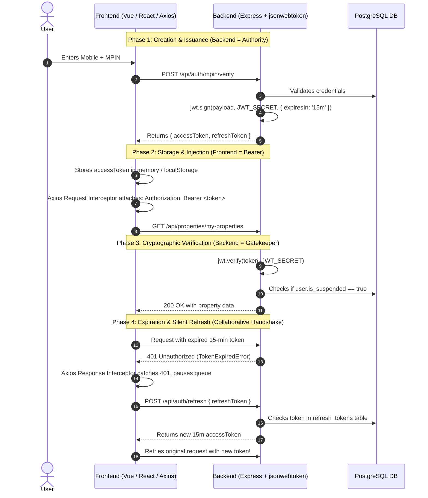
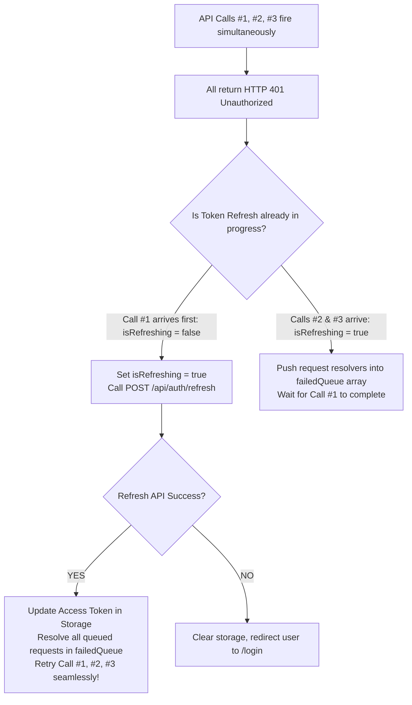
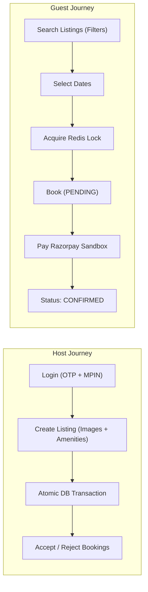
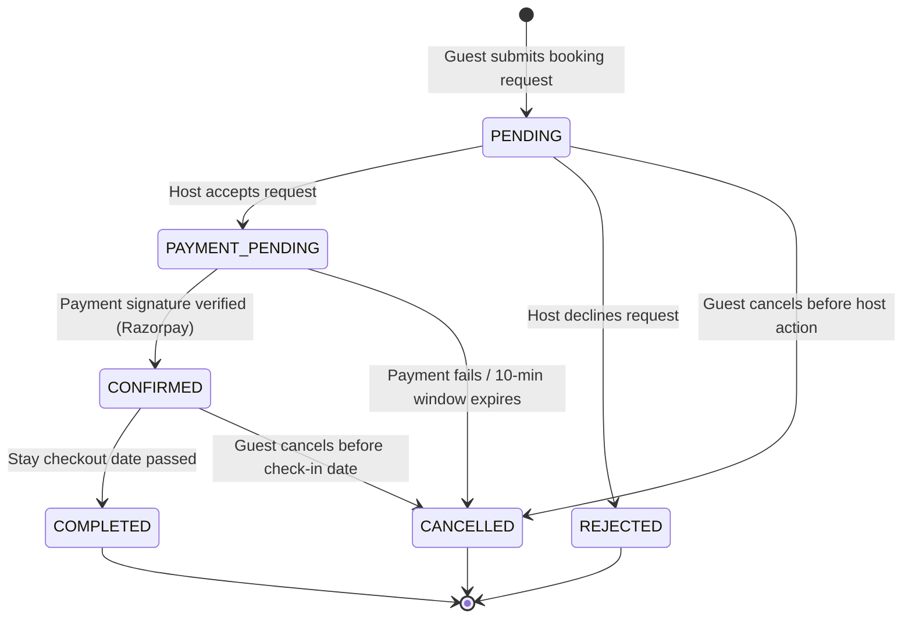
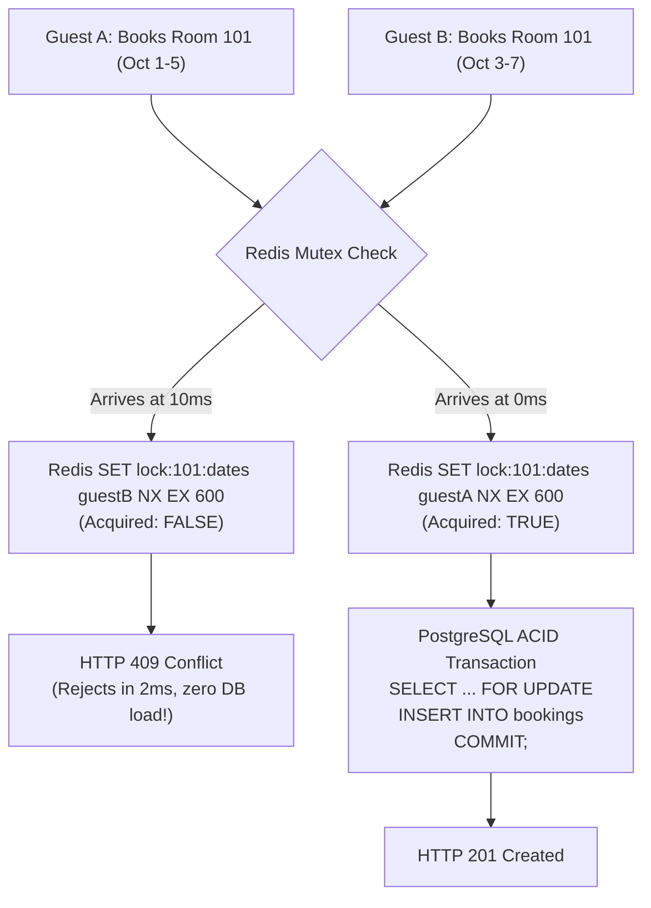
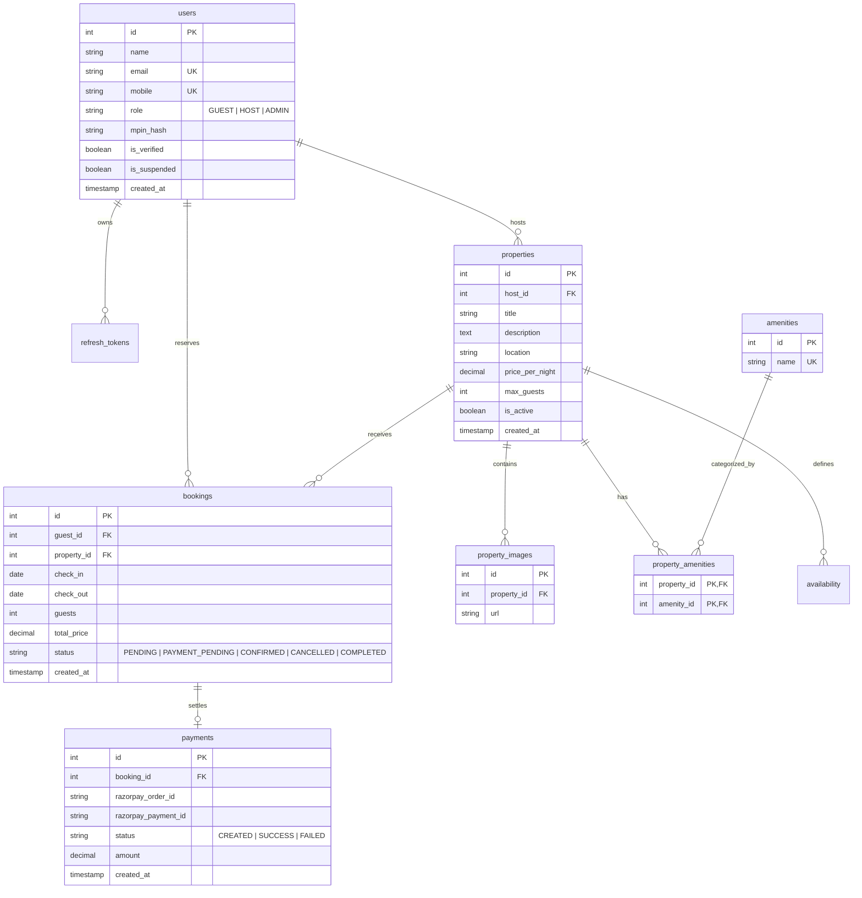

# Vistora — Complete System Flow, Code Architecture & Comprehensive Interview Masterclass

> **Document Scope:** Full Functional, Code-Wise Architecture, Deep-Dive Auth Guide & 25+ Interview Q&A  
> **Target Role:** Node.js Full-Stack Developer (1–2 Years Experience)  
> **Candidate:** Omkar Swami  
> **Tech Stack:** Node.js, Express, PostgreSQL (`pg`), Redis, Zod, bcrypt, JWT, Axios, Vue 3, Razorpay Sandbox  

---

## Table of Contents
1. [The "Interview Trap" Breakdown: Authentication vs Authorization & JWT Lifecycle](#1-the-interview-trap-breakdown-authentication-vs-authorization--jwt-lifecycle)
   - [1.1 Authentication vs Authorization (Never Get Confused Again)](#11-authentication-vs-authorization-never-get-confused-again)
   - [1.2 "Where is JWT Handled? Frontend or Backend?" (The Trap Question Solved)](#12-where-is-jwt-handled-frontend-or-backend-the-trap-question-solved)
   - [1.3 JWT Anatomy & Why Base64 is NOT Encryption](#13-jwt-anatomy--why-base64-is-not-encryption)
   - [1.4 Where to Store Tokens? localStorage vs httpOnly Cookie vs Memory](#14-where-to-store-tokens-localstorage-vs-httponly-cookie-vs-memory)
   - [1.5 How Frontend Handles Silent Refresh: The Axios Queue Pattern](#15-how-frontend-handles-silent-refresh-the-axios-queue-pattern)
2. [Vistora's Multi-Auth Architecture (6-Tier Security Engine)](#2-vistoras-multi-auth-architecture-6-tier-security-engine)
   - [2.1 Layer 1: Phone-First Identity & Role OTP](#21-layer-1-phone-first-identity--role-otp)
   - [2.2 Layer 2: The 2-Minute Signed `otpTicket` Bridge](#22-layer-2-the-2-minute-signed-otpticket-bridge)
   - [2.3 Layer 3: 4-Digit MPIN Hashing with bcrypt](#23-layer-3-4-digit-mpin-hashing-with-bcrypt)
   - [2.4 Layer 4: Dual-Token Session (15m Access JWT + 7d DB Refresh Token)](#24-layer-4-dual-token-session-15m-access-jwt--7d-db-refresh-token)
   - [2.5 Layer 5: Soft Tab-Lock Re-authorization (Page Visibility API)](#25-layer-5-soft-tab-lock-re-authorization-page-visibility-api)
   - [2.6 Layer 6: Real-Time User Suspension Check in Middleware](#26-layer-6-real-time-user-suspension-check-in-middleware)
3. [End-to-End Functional Flows (User Journeys)](#3-end-to-end-functional-flows-user-journeys)
   - [3.1 Guest & Host Passwordless Authentication Flow](#31-guest--host-passwordless-authentication-flow)
   - [3.2 Host Property Listing Flow (Atomic ACID Transaction)](#32-host-property-listing-flow-atomic-acid-transaction)
   - [3.3 Guest Search & Discovery Flow](#33-guest-search--discovery-flow)
   - [3.4 Guest Booking Reservation Flow](#34-guest-booking-reservation-flow)
   - [3.5 Payment & State Machine Confirmation Flow](#35-payment--state-machine-confirmation-flow)
4. [Booking State Machine & Concurrency Control](#4-booking-state-machine--concurrency-control)
   - [4.1 Strict Booking State Transitions](#41-strict-booking-state-transitions)
   - [4.2 Two-Tier Concurrency: Redis Mutex vs PostgreSQL Row Locks](#42-two-tier-concurrency-redis-mutex-vs-postgresql-row-locks)
5. [Code-Wise Architecture: The 5-Layer Pattern](#5-code-wise-architecture-the-5-layer-pattern)
   - [5.1 Layer Responsibilities & Strict Rules](#51-layer-responsibilities--strict-rules)
   - [5.2 Complete Request Lifecycle Trace (`POST /api/properties`)](#52-complete-request-lifecycle-trace-post-apiproperties)
6. [Database Schema & Advanced SQL Engine](#6-database-schema--advanced-sql-engine)
   - [6.1 Entity-Relationship Diagram](#61-entity-relationship-diagram)
   - [6.2 Advanced SQL Techniques Used in Vistora](#62-advanced-sql-techniques-used-in-vistora)
7. [Comprehensive Interview Masterclass: 25+ Technical Q&A](#7-comprehensive-interview-masterclass-25-technical-qa)
   - [Category A: Core Full-Stack & Web Fundamentals (Q1–Q6)](#category-a-core-full-stack--web-fundamentals-q1q6)
   - [Category B: Authentication, JWT & Security Deep-Dive (Q7–Q14)](#category-b-authentication-jwt--security-deep-dive-q7q14)
   - [Category C: Node.js, Express & Architecture (Q15–Q19)](#category-c-nodejs-express--architecture-q15q19)
   - [Category D: PostgreSQL, Raw SQL & Concurrency (Q20–Q25)](#category-d-postgresql-raw-sql--concurrency-q20q25)
8. [Backend Completion Blueprint (Next Action Steps)](#8-backend-completion-blueprint-next-action-steps)

---

# 1. The "Interview Trap" Breakdown: Authentication vs Authorization & JWT Lifecycle

> [!IMPORTANT]
> This section is specifically created to ensure you **never get stuck or tongue-tied** when an interviewer drills you on Authentication, Authorization, or the JWT lifecycle.

---

## 1.1 Authentication vs Authorization (Never Get Confused Again)

Interviewers love testing whether a 1-year developer truly understands the difference or just uses the words interchangeably.

```
┌────────────────────────────────────────────────────────┐
│                      AUTHENTICATION                    │
│                 "WHO ARE YOU?" (Identity)              │
│  - User submits Mobile + OTP + MPIN                    │
│  - System checks identity in database                  │
│  - Status code on failure: 401 Unauthorized            │
└───────────────────────────┬────────────────────────────┘
                            │ Identity verified! Token issued.
                            ▼
┌────────────────────────────────────────────────────────┐
│                      AUTHORIZATION                     │
│                "WHAT CAN YOU DO?" (Permissions)        │
│  - Verified User attempts to POST /api/properties      │
│  - System checks: Does user.role == 'HOST'?            │
│  - Status code on failure: 403 Forbidden               │
└────────────────────────────────────────────────────────┘
```

### The Real-World Airport Analogy (Use This in Your Interview!)
> *"Think of an airport:  
> 1. **Authentication** is at the entrance security gate where you show your Passport and Aadhaar Card. The guard verifies: 'Yes, you are Omkar Swami.' You have proven **who you are**.  
> 2. **Authorization** is at the Cockpit door. You show your economy-class boarding pass. The flight attendant stops you: 'We know you are Omkar, but you are not authorized to enter the cockpit.' You have identity, but **lack permission**."*

### HTTP Status Code Distinction
| Status Code | Standard Name | What It Actually Means | When Vistora Returns It |
|---|---|---|---|
| **401** | `Unauthorized` | *"You are not authenticated / Your token is missing or expired."* | Missing Bearer token in [`auth.middleware.js`](file:///O:/projects/VistoraServer/src/middleware/auth.middleware.js#L8-L12), invalid JWT, or expired token. |
| **403** | `Forbidden` | *"We know who you are, but you don't have permission for this resource."* | Guest tries to call [`POST /api/properties`](file:///O:/projects/VistoraServer/src/modules/properties/property.routes.js#L26-L33) (guarded by `requireRole(['HOST'])`), or user is suspended (`is_suspended: true`). |

---

## 1.2 "Where is JWT Handled? Frontend or Backend?" (The Trap Question Solved)

### The Interviewer's Trap
- If you answer: *"It's handled on the backend"*, they will say: *"Then what does frontend do? Doesn't frontend store and send it?"*
- If you answer: *"It's handled on the frontend"*, they will say: *"Can the frontend create or verify the cryptographic signature? No! Anyone could fake it!"*

### The Perfect Senior Answer (Say This Word-for-Word):
> *"JWT is a **collaborative client-server handshake** with strictly divided responsibilities:  
> - The **Backend is the Cryptographic Authority**: It signs the token using a private `JWT_SECRET`, defines the payload and expiration, cryptographically verifies incoming signatures, checks user revocation against the database, and issues new tokens.  
> - The **Frontend is the Bearer & Session Manager**: It securely receives the token, stores it, automatically injects it into every outgoing request's `Authorization: Bearer` header, listens for 401 expiration responses via Axios interceptors, triggers silent refresh calls, and purges the token upon logout."*

### Side-by-Side Comparison: Backend vs Frontend Responsibilities



---

## 1.3 JWT Anatomy & Why Base64 is NOT Encryption

An interviewer might ask: *"Is the JWT payload encrypted? Can a hacker read the data inside it?"*

### The Answer:
> *"No, a standard JWT is **signed**, not encrypted. It uses Base64Url encoding, which is plain text and can be decoded by anyone on `jwt.io` without a secret. What makes JWT secure is the **Signature**."*

A JWT has three parts separated by dots (`.`):
$$\underbrace{\text{eyJhbGciOi...}}_{\text{Header}} \ . \ \underbrace{\text{eyJ1c2VySW...}}_{\text{Payload}} \ . \ \underbrace{\text{TJVA95OrM7...}}_{\text{Signature}}$$

1. **Header:** Algorithm and token type (e.g., `{"alg": "HS256", "typ": "JWT"}`).
2. **Payload (Claims):** Data claims (e.g., `{"userId": 7, "role": "HOST", "exp": 1729000000}`).
   > [!CAUTION]
   > **Never store sensitive data (passwords, MPINs, card numbers) inside a JWT payload**, because anyone who intercepts the token can read it.
3. **Signature:** Calculated using the server's private secret:
   $$\text{HMACSHA256}(\text{base64UrlEncode}(\text{Header}) + "." + \text{base64UrlEncode}(\text{Payload}), \ \text{JWT\_SECRET})$$
   If an attacker changes `"role": "GUEST"` to `"role": "ADMIN"` in the payload, the signature verification fails because the attacker doesn't possess `JWT_SECRET`.

---

## 1.4 Where to Store Tokens? localStorage vs httpOnly Cookie vs Memory

| Storage Location | XSS Vulnerability | CSRF Vulnerability | Persistence on Refresh | Best Practice Evaluation |
|---|---|---|---|---|
| **`localStorage`** | ❌ **High Risk** (Any malicious JS script can read `localStorage.getItem()`) | ✅ **Immune** (Browsers never send it automatically) | ✅ Persists across tabs and reloads | Common in MVPs & decoupled mobile clients; requires strict CSP. |
| **`httpOnly Cookie`** | ✅ **Immune to JS** (`document.cookie` cannot read it) | ⚠️ **Vulnerable** (Browser attaches cookie automatically on cross-site requests) | ✅ Persists | **Gold Standard** when paired with `SameSite=Strict` and CSRF protection tokens. |
| **In-Memory (React / Pinia state)** | ✅ **Safe** (Not accessible via storage APIs) | ✅ **Immune** | ❌ Lost on page refresh (needs silent refresh on mount) | Most secure for Access Tokens, paired with an httpOnly Refresh Cookie. |

---

## 1.5 How Frontend Handles Silent Refresh: The Axios Queue Pattern

A common production challenge: What happens when 5 API calls fire at the same time and the access token has just expired? You cannot make 5 simultaneous refresh calls!



---

# 2. Vistora's Multi-Auth Architecture (6-Tier Security Engine)

Vistora does not use a single "login" endpoint. It implements a layered, fintech-grade security pipeline:

```
[User Identity: Mobile Number]
           │
           ▼
[Tier 1: OTP Layer]           POST /api/auth/otp/request & /otp/verify
           │                  (Validates phone ownership, updates is_verified = true)
           ▼
[Tier 2: Bridge Token]        Issues 2-Minute Signed otpTicket JWT
           │                  (Cryptographically locks client to next step)
           ▼
[Tier 3: MPIN Layer]          POST /api/auth/mpin/set & /mpin/verify
           │                  (bcrypt 10 salt rounds; validates otpTicket)
           ▼
[Tier 4: Dual-Session Tokens] Issues: 15-min Access Token + 7-day DB Refresh Token
           │                  (Access in Header, Refresh revocable in PostgreSQL)
           ▼
[Tier 5: Soft Tab-Lock]       POST /api/auth/mpin/unlock
           │                  (Gated by Page Visibility API; re-checks MPIN in-session)
           ▼
[Tier 6: Real-Time Gate]      authMiddleware + requireRole(['HOST'])
                              (Queries DB on every request to block suspended users)
```

---

## 2.1 Layer 1: Phone-First Identity & Role OTP
- Identity is anchored to a mobile number (`mobile VARCHAR(15) UNIQUE`).
- OTP values are hardcoded per role in development:
  - **Guest:** `999999`
  - **Host:** `118899`
  - **Admin:** `55555`
- **Interview Defense:** *"Real SMS delivery (Twilio / AWS SNS) is deliberately abstracted behind a clean provider function in `auth.service.js`. Swapping the mock table for an SMS provider requires changing one function without touching any controllers or routes."*

## 2.2 Layer 2: The 2-Minute Signed `otpTicket` Bridge
- Generated in [`auth.service.js`](file:///O:/projects/VistoraServer/src/modules/auth/auth.service.js#L158-L167):
  ```javascript
  const otpTicket = jwt.sign(
    { userId: user.id, mobile: user.mobile, role: user.role, purpose: 'OTP_VERIFIED' },
    process.env.JWT_SECRET,
    { expiresIn: '2m' }
  );
  ```
- **Why this exists:** Prevents attackers from brute-forcing 4-digit PINs directly against `/api/auth/mpin/verify`. You cannot touch the MPIN endpoint without a valid ticket signed within the last 120 seconds.

## 2.3 Layer 3: 4-Digit MPIN Hashing with bcrypt
- 4-digit MPIN is hashed using **bcrypt with 10 salt rounds**.
- Stored as `mpin_hash VARCHAR(255)` in PostgreSQL.
- Plaintext MPIN is never logged, never cached, and never returned in API responses.

## 2.4 Layer 4: Dual-Token Session (15m Access JWT + 7d DB Refresh Token)
- **Access Token:** 15-minute lifespan. Fast, stateless verification in memory.
- **Refresh Token:** 7-day lifespan. Persisted in PostgreSQL table `refresh_tokens`.
- **Revocation on Logout:** Calling `POST /api/auth/logout` deletes the refresh token record from the database, preventing session reuse.

## 2.5 Layer 5: Soft Tab-Lock Re-authorization (Page Visibility API)
- When the user minimizes or navigates away from the browser tab, the frontend detects `document.visibilityState === 'hidden'`.
- On return, an MPIN prompt overlay covers the app.
- Calling `POST /api/auth/mpin/unlock` verifies the MPIN against the already-authenticated user session without issuing new tokens or disturbing in-flight network requests.

## 2.6 Layer 6: Real-Time User Suspension Check in Middleware
- In pure stateless JWTs, a suspended user can make calls until the token expires (15 minutes).
- In Vistora's [`auth.middleware.js`](file:///O:/projects/VistoraServer/src/middleware/auth.middleware.js#L36-L48):
  ```javascript
  const user = await authRepository.findUserById(decoded.userId);
  if (user.is_suspended) {
    return res.status(403).json({ message: 'This account has been suspended' });
  }
  ```
- Suspension takes effect **instantly on the very next HTTP request**.

---

# 3. End-to-End Functional Flows (User Journeys)



### 3.1 Guest & Host Passwordless Authentication Flow
1. User enters mobile number $\to$ backend checks existence $\to$ OTP logged in terminal.
2. User enters OTP $\to$ backend marks `is_verified = true` $\to$ issues 2-min `otpTicket`.
3. First-time user calls `/api/auth/mpin/set` $\to$ sets 4-digit PIN $\to$ receives Access + Refresh tokens.
4. Returning user calls `/api/auth/mpin/verify` $\to$ verifies PIN $\to$ receives Access + Refresh tokens.

### 3.2 Host Property Listing Flow (Atomic ACID Transaction)
- Host submits title, description, location, price, max guests, image URLs array, and amenity IDs array.
- Database executes multi-table transaction in [`property.repository.js`](file:///O:/projects/VistoraServer/src/modules/properties/property.repository.js#L4-L85):
  - `INSERT INTO properties` $\to$ returns new property ID.
  - Bulk inserts images using `UNNEST($2::text[])`.
  - Bulk inserts amenities using CTE `WITH inserted AS (...) SELECT ...`.
  - `COMMIT` on success, `ROLLBACK` on any error.

### 3.3 Guest Search & Discovery Flow
- Public browsing via `GET /api/properties`.
- Supports query params: `location`, `min_price`, `max_price`, `guests`, `check_in`, `check_out`.
- Detailed view via `GET /api/properties/:id` aggregates images and amenities using PostgreSQL `JSON_AGG(DISTINCT ...)`.

### 3.4 Guest Booking Reservation Flow
- Guest selects check-in and check-out dates.
- Redis lock is acquired for the property and date range for 10 minutes (`EX 600 NX`).
- PostgreSQL query checks for conflicting bookings in `CONFIRMED` or `PAYMENT_PENDING` status using row-level locking (`FOR UPDATE`).
- Booking is created with initial status `PENDING`.

### 3.5 Payment & State Machine Confirmation Flow
- Host accepts booking request $\to$ status transitions to `PAYMENT_PENDING`.
- Backend generates Razorpay Order ID.
- Guest completes sandbox payment $\to$ backend verifies HMAC-SHA256 signature.
- Status transitions to `CONFIRMED` $\to$ Redis lock is released.

---

# 4. Booking State Machine & Concurrency Control



## 4.1 Strict Booking State Transitions
Enforced by `booking.statemachine.js`:
```javascript
const ALLOWED_TRANSITIONS = {
  PENDING: ['PAYMENT_PENDING', 'REJECTED', 'CANCELLED'],
  PAYMENT_PENDING: ['CONFIRMED', 'CANCELLED'],
  CONFIRMED: ['COMPLETED', 'CANCELLED'],
  COMPLETED: [],
  CANCELLED: [],
  REJECTED: [],
};

function canTransition(currentStatus, nextStatus) {
  const allowed = ALLOWED_TRANSITIONS[currentStatus] || [];
  return allowed.includes(nextStatus);
}
```

---

## 4.2 Two-Tier Concurrency: Redis Mutex vs PostgreSQL Row Locks



### Why Both Are Essential:
1. **Redis Lock (Performance Layer):** Absorbs high-traffic bursts (flash sales, holiday rushes) in memory. Rejects 99% of conflicting requests in ~2ms.
2. **PostgreSQL `FOR UPDATE` (Integrity Layer):** The true source of truth. Even if Redis loses power or restarts, the ACID database transaction prevents double-booking.

---

# 5. Code-Wise Architecture: The 5-Layer Pattern

Vistora follows a strict **Unidirectional Layered Monolith**:

```
[HTTP Request]
       │
       ▼
[1. Route Layer]          *.routes.js        (URL matching & middleware chaining)
       │
       ▼
[2. Validation Layer]     validate.middleware.js + Zod schemas (Input sanitization)
       │
       ▼
[3. Controller Layer]     *.controller.js    (HTTP protocol adapter, status codes)
       │
       ▼
[4. Service Layer]        *.service.js       (Domain business rules, cryptography)
       │
       ▼
[5. Repository Layer]     *.repository.js    (Raw SQL queries, $1 placeholders)
       │
       ▼
[PostgreSQL Database]     Aiven Cloud PostgreSQL Pool
```

---

## 5.1 Layer Responsibilities & Strict Rules

| Layer | Responsibility | What is NEVER Allowed Here |
|---|---|---|
| **Route** | Declares endpoints, chains middlewares in strict order. | Business logic, SQL queries, direct response sending. |
| **Validation** | Uses Zod `.strict()` to reject bad payloads early. | Database queries, session token verification. |
| **Controller** | Extracts parameters, calls Service, sends HTTP status codes. | SQL queries, password/MPIN hashing algorithms. |
| **Service** | Core business logic, bcrypt hashing, JWT issuance, AppError. | Accessing Express `req` or `res` objects. |
| **Repository** | Parameterized SQL queries (`$1, $2`), transactions. | HTTP status codes, business rule decisions. |

---

## 5.2 Complete Request Lifecycle Trace (`POST /api/properties`)

```
Step 1: Client Request
POST http://localhost:5000/api/properties
Headers: { "Authorization": "Bearer <JWT>" }
Body: { "title": "Beach Villa", "location": "Goa", "price_per_night": 5000, "max_guests": 4, "images": [...], "amenity_ids": [1, 2] }
   │
   ▼
Step 2: Route Layer (property.routes.js)
router.post('/', authMiddleware, requireRole(['HOST']), validate(createPropertySchema), propertyController.createProperty);
   │
   ▼
Step 3: authMiddleware (auth.middleware.js)
1. Checks Authorization header starts with 'Bearer '.
2. Verifies token with jwt.verify().
3. Looks up user in DB: findUserById(decoded.userId).
4. Verifies user.is_suspended === false.
5. Populates req.user = { id: 7, role: 'HOST', ... }.
   │
   ▼
Step 4: roleMiddleware (role.middleware.js)
Checks requireRole(['HOST']). Since req.user.role === 'HOST', calls next().
   │
   ▼
Step 5: validateMiddleware (validate.middleware.js)
Runs createPropertySchema.safeParse(req.body). Sanitizes and types data.
   │
   ▼
Step 6: Controller (property.controller.js)
Calls propertyService.createProperty(req.user.id, req.body).
   │
   ▼
Step 7: Service (property.service.js)
Extracts images and amenityIds; prepares clean propertyData object.
Calls propertyRepository.createPropertyWithDetails(propertyData, images, amenityIds).
   │
   ▼
Step 8: Repository (property.repository.js)
1. const client = await pool.connect();
2. await client.query('BEGIN');
3. INSERT INTO properties (...) RETURNING *;
4. INSERT INTO property_images (property_id, url) SELECT $1, UNNEST($2::text[]);
5. WITH inserted AS (
     INSERT INTO property_amenities (property_id, amenity_id)
     SELECT $1, UNNEST($2::int[]) ON CONFLICT DO NOTHING
   ) SELECT a.id, a.name FROM amenities a JOIN property_amenities pa ON pa.amenity_id = a.id ...;
6. await client.query('COMMIT');
7. client.release();
   │
   ▼
Step 9: HTTP Response
Controller returns HTTP 201 Created:
{ "message": "Property created successfully", "property": { "id": 15, "title": "Beach Villa", ... } }
```

---

# 6. Database Schema & Advanced SQL Engine

## 6.1 Entity-Relationship Diagram



---

## 6.2 Advanced SQL Techniques Used in Vistora

### 1. `JSON_AGG` & `DISTINCT` (Preventing Cartesian Product Duplication)
Joining photos (5 rows) and amenities (4 rows) on properties produces $5 \times 4 = 20$ rows. PostgreSQL aggregates them directly into JSON arrays:
```sql
SELECT
  p.*,
  u.name AS host_name,
  COALESCE(
    JSON_AGG(DISTINCT JSONB_BUILD_OBJECT('id', pi.id, 'url', pi.url))
    FILTER (WHERE pi.id IS NOT NULL), '[]'
  ) AS images,
  COALESCE(
    JSON_AGG(DISTINCT JSONB_BUILD_OBJECT('id', a.id, 'name', a.name))
    FILTER (WHERE a.id IS NOT NULL), '[]'
  ) AS amenities
FROM properties p
JOIN users u ON p.host_id = u.id
LEFT JOIN property_images pi ON p.id = pi.property_id
LEFT JOIN property_amenities pa ON p.id = pa.property_id
LEFT JOIN amenities a ON pa.amenity_id = a.id
WHERE p.id = $1
GROUP BY p.id, u.id;
```

### 2. Bulk Insert with `UNNEST`
Inserts an entire JavaScript array in one SQL query without string concatenation:
```sql
INSERT INTO property_images (property_id, url)
SELECT $1, UNNEST($2::text[])
RETURNING id, url;
```

### 3. Date Overlap Formula with Row Locking
```sql
SELECT id FROM bookings
WHERE property_id = $1
  AND status IN ('CONFIRMED', 'PAYMENT_PENDING')
  AND NOT (check_out <= $2 OR check_in >= $3)
FOR UPDATE;
```

---

# 7. Comprehensive Interview Masterclass: 25+ Technical Q&A

These questions cover everything an interviewer might ask a 1-year experience Node.js Full-Stack Developer. Practice them out loud!

---

### Category A: Core Full-Stack & Web Fundamentals

#### Q1: What is the difference between Authentication and Authorization?
> **Answer:**  
> "Authentication is verifying **who you are**—confirming your identity through credentials like mobile OTP or MPIN. Authorization is determining **what you are allowed to do**—checking permissions and roles after identity is established. If authentication fails, the server returns HTTP 401 Unauthorized. If authorization fails, it returns HTTP 403 Forbidden."

#### Q2: What is the difference between HTTP 401 Unauthorized and HTTP 403 Forbidden?
> **Answer:**  
> "HTTP 401 means the client is unauthenticated—either the token is missing, malformed, or expired. HTTP 403 means the server knows exactly who the client is, but that user does not have permission to access the resource. For example, in Vistora, if a Guest tries to create a property listing, they receive a 403 Forbidden because that endpoint requires the `HOST` role."

#### Q3: HTTP is stateless. How does your backend remember who made the request?
> **Answer:**  
> "Since HTTP does not retain state between requests, we use token-based authentication. Upon login, the server issues a cryptographically signed JSON Web Token. On every subsequent request, the client passes this token in the `Authorization: Bearer <token>` header. The server verifies the token's cryptographic signature and extracts the user claims, identifying the caller without maintaining in-memory session states."

#### Q4: What is the difference between Hashing and Encryption?
> **Answer:**  
> "Hashing is a **one-way function**: once data is hashed (e.g., using bcrypt for our MPINs), it cannot be reversed back into plaintext. It is used to verify passwords and PINs without ever storing the secret. Encryption is a **two-way function**: data is scrambled using an encryption key and can be decrypted back into its original form using a key (e.g., AES). Passwords and MPINs must always be hashed, never encrypted."

#### Q5: What is SQL Injection and how did you prevent it without using an ORM?
> **Answer:**  
> "SQL Injection occurs when untrusted user input is directly concatenated into a SQL string, allowing an attacker to manipulate the query logic. I prevented this by using **parameterized queries** with PostgreSQL's `$1, $2` placeholders via the `pg` library. The database engine treats parameters strictly as literal data values, never as executable SQL code."

#### Q6: What is CORS and why does a browser send an `OPTIONS` preflight request?
> **Answer:**  
> "CORS (Cross-Origin Resource Sharing) is a browser security mechanism that restricts a web page from making requests to a different domain, port, or protocol. For non-simple HTTP requests—such as requests sending `Content-Type: application/json` or custom `Authorization` headers—the browser automatically sends an `OPTIONS` preflight request to verify whether the server permits that cross-origin method and headers before dispatching the actual request."

---

### Category B: Authentication, JWT & Security Deep-Dive

#### Q7: Where is JWT handled: Frontend or Backend?
> **Answer:**  
> "It is a collaborative handshake. The **Backend** is the cryptographic authority: it signs the JWT using a private secret, verifies signatures, checks user suspension, and handles token issuance and revocation. The **Frontend** acts as the bearer and session manager: it stores the token, injects it into every outgoing request's `Authorization: Bearer` header, intercepts 401 expiration responses using Axios interceptors, triggers silent refresh calls, and purges the token upon logout."

#### Q8: What are the three parts of a JWT? Is the payload encrypted?
> **Answer:**  
> "A JWT consists of Header, Payload, and Signature, separated by dots. The payload is **Base64Url-encoded, not encrypted**—anyone can decode and read its claims. The security comes entirely from the Signature, which is generated using a server-side secret (`HMACSHA256`). If an attacker tampers with the payload, the signature verification on the backend fails immediately."

#### Q9: Why do you use a Dual-Token Strategy (Access Token + Refresh Token)?
> **Answer:**  
> "To balance security and user experience. Access tokens are short-lived—15 minutes—limiting the exposure window if intercepted. Refresh tokens live for 7 days and are stored server-side in our PostgreSQL database. This allows the frontend to silently renew expired access tokens in the background without forcing the user to log in repeatedly, while still allowing the backend to revoke sessions on logout or suspension by deleting the refresh token."

#### Q10: What is the purpose of the 2-minute signed `otpTicket`?
> **Answer:**  
> "The `otpTicket` is a short-lived cryptographic JWT bridging OTP verification and MPIN verification. Without this ticket, an attacker could bypass OTP verification entirely and call `/api/auth/mpin/verify` or `/mpin/set` directly. The ticket contains claims for `userId`, `mobile`, and `purpose: 'OTP_VERIFIED'`. The MPIN endpoints verify these claims before checking the MPIN hash, ensuring that only a client that completed OTP verification within the last 120 seconds can proceed."

#### Q11: Where do you store tokens on the frontend, and what are the security trade-offs?
> **Answer:**  
> "Storing tokens in `localStorage` makes them vulnerable to Cross-Site Scripting (XSS) attacks because any injected script can read storage. Storing them in `httpOnly` cookies protects them from JavaScript access, but introduces Cross-Site Request Forgery (CSRF) risks. The industry standard is storing short-lived access tokens in memory or `localStorage` with strict Content Security Policies, while keeping refresh tokens in `httpOnly, Secure, SameSite=Strict` cookies."

#### Q12: How does your frontend Axios interceptor handle token expiration and concurrent requests?
> **Answer:**  
> "Our Axios response interceptor intercepts HTTP 401 errors. If a refresh request is already running, subsequent requests push their resolve/reject callbacks into a `failedQueue` array. The initial 401 triggers `POST /api/auth/refresh`. Once the new access token is received, we resolve all queued requests with the new token and retry the original call seamlessly. If the refresh fails, we clear storage and redirect to `/login`."

#### Q13: How do you block suspended users in real time if JWT is stateless?
> **Answer:**  
> "Purely stateless JWT validation only checks the signature and expiration timestamp, meaning a suspended user could continue making requests until the token expires. To fix this, our `authMiddleware` queries PostgreSQL using `findUserById(decoded.userId)` on every authenticated request. If `user.is_suspended` is true, it immediately aborts with an HTTP 403 Forbidden response, revoking access in real time."

#### Q14: How does the soft MPIN tab-lock work?
> **Answer:**  
> "The frontend uses the HTML5 Page Visibility API. When a user switches tabs, `document.visibilityState` becomes `hidden`. Upon returning, Pinia sets `isLocked = true` and renders an MPIN overlay. The user enters their MPIN, which calls `POST /api/auth/mpin/unlock` using their active access token. The backend verifies the MPIN hash and returns `{ unlocked: true }` without regenerating tokens, keeping active network requests and session state completely intact."

---

### Category C: Node.js, Express & Architecture

#### Q15: How does the Node.js Event Loop work?
> **Answer:**  
> "Node.js runs on a single-threaded event loop powered by libuv. It executes synchronous JavaScript on the Call Stack. When an asynchronous operation (such as a database query or network call) occurs, it is offloaded to the operating system kernel or libuv's thread pool. Once completed, the callback is pushed to the Event Queue (or Microtask Queue for Promises) and picked up by the Event Loop when the Call Stack becomes empty."

#### Q16: Explain your 5-layer backend architecture.
> **Answer:**  
> "The backend follows a 5-layer structure:  
> 1. **Route Layer:** Maps URLs and chains middlewares.  
> 2. **Validation Layer:** Uses Zod `.strict()` to sanitize request bodies before business logic runs.  
> 3. **Controller Layer:** Extracts parameters and formats HTTP responses.  
> 4. **Service Layer:** Pure domain logic, cryptography, and token generation.  
> 5. **Repository Layer:** Parameterized SQL queries and database transactions.  
> Each module exposes a single `index.js`, making modules self-contained black boxes."

#### Q17: How does your centralized error handling architecture work?
> **Answer:**  
> "We created an `AppError` class that extends JavaScript's `Error`, adding an HTTP `statusCode` and an `isOperational = true` flag. Services throw operational errors (e.g., duplicate email $\to$ 409). Controllers catch errors and forward them via `next(error)`. A global error middleware catches all errors: operational errors return their specific status code and message, while unhandled 500 errors log the stack trace to the console and return a clean, secure error message to the client."

#### Q18: What is connection pooling in `pg` and why is it important?
> **Answer:**  
> "Establishing a new TCP and SSL connection to a PostgreSQL database on every HTTP request is slow and resource-intensive. Connection pooling maintains a pool of pre-warmed database connections. When a request comes in, it checks out an available client, runs the query, and immediately releases the client back to the pool for reuse, allowing the application to handle hundreds of concurrent requests efficiently."

#### Q19: What is the role of `Zod` in your validation middleware?
> **Answer:**  
> "Zod acts as our gatekeeper. The `validate(schema)` middleware runs `schema.safeParse(req.body)`. If validation fails, it immediately halts execution with an HTTP 400 Bad Request and returns structured field-level error messages. It also strips unexpected fields (`.strict()`), ensuring malicious parameters are dropped before touching the controller or database."

---

### Category D: PostgreSQL, Raw SQL & Concurrency

#### Q20: Why did you choose raw SQL with `pg` instead of an ORM like Prisma or TypeORM?
> **Answer:**  
> "I chose raw SQL to retain full control over query performance, database-level locking, and connection pooling. ORMs often abstract away transactions and produce inefficient subqueries or N+1 query problems when fetching nested relations like images and amenities. With raw SQL, I wrote clean parameterized queries, used PostgreSQL's `JSON_AGG` to serialize relational data directly in the database engine in a single round-trip, and wrote explicit ACID transactions with `BEGIN`, `COMMIT`, and `ROLLBACK`."

#### Q21: What is the Cartesian product fan-out problem and how did you solve it using `JSON_AGG`?
> **Answer:**  
> "When joining a property with multiple 1-to-N relations—like 5 images and 4 amenities—a standard join multiplies the rows ($5 \times 4 = 20$ rows), duplicating property data 20 times. I solved this by using PostgreSQL's `JSON_AGG(DISTINCT JSONB_BUILD_OBJECT(...))`. The database engine aggregates related photos and amenities directly into nested JSON arrays in a single query round-trip, eliminating data duplication."

#### Q22: Why was the `DISTINCT` keyword necessary inside `JSON_AGG`?
> **Answer:**  
> "Because we perform two `LEFT JOIN` operations simultaneously: one on `property_images` and one on `property_amenities`. The double join produces a Cartesian product. Without `DISTINCT`, `JSON_AGG` would aggregate the same photo multiple times for every matched amenity. Adding `DISTINCT` inside the aggregation deduplicates entries before serializing them into JSON."

#### Q23: How did you implement database transactions when creating a property?
> **Answer:**  
> "Creating a property requires inserting records into three separate tables: `properties`, `property_images`, and `property_amenities`. I check out a dedicated client from the pool and wrap the queries in `BEGIN`, `COMMIT`, and `ROLLBACK`. First, we insert the property to get its ID. Then we bulk-insert photos using `UNNEST()` and amenities using a CTE. If any insert fails, the transaction rolls back, preventing orphaned properties without photos or amenities."

#### Q24: How do you prevent double-booking race conditions?
> **Answer:**  
> "I implemented a two-tier concurrency control strategy:  
> 1. **Redis Distributed Mutex:** When a booking is initiated, we set `SET lock:property:{id}:{dates} {guestId} NX EX 600`. If another user attempts to book the same dates, the lock fails, rejecting the request in ~2ms without hitting PostgreSQL.  
> 2. **PostgreSQL Row Lock:** Inside the booking transaction, we query conflicting bookings with `SELECT ... FOR UPDATE` and a date overlap condition `NOT (check_out <= $2 OR check_in >= $3)`. The `FOR UPDATE` locks conflicting rows at the database level, guaranteeing ACID consistency."

#### Q25: Why do you need both Redis locks AND database row locks? Isn't one enough?
> **Answer:**  
> "They serve complementary purposes:  
> - Redis provides **in-memory speed and protection**: during peak traffic (e.g., flash sales), it deflects 99% of conflicting requests in milliseconds, protecting the database connection pool from lock exhaustion.  
> - PostgreSQL provides the **durable source of truth**: if the Redis instance restarts, crashes, or suffers a network partition, the database transaction guarantees that double-booking is physically impossible at the data layer."

---

# 8. Backend Completion Blueprint (Next Action Steps)

To complete the backend and make it 100% demo-ready:

```
[Phase 4: Search & Filters]
  └── Dynamic SQL query builder in property.repository.js (ILIKE, price BETWEEN, guests >=)

[Phase 5: Booking Core + State Machine]
  ├── Database migration: bookings table (PostgreSQL)
  ├── booking.statemachine.js: Transition validator
  ├── booking.repository.js: Overlap query with FOR UPDATE
  └── booking.service.js & booking.controller.js: Booking lifecycle endpoints

[Phase 6: Redis Concurrency Locking]
  ├── config/redis.js: ioredis client
  └── Redis lock acquisition and release helpers in booking creation flow

[Phase 7: Razorpay Sandbox Payments]
  ├── Database migration: payments table
  ├── Razorpay order creation endpoint
  └── Signature verification endpoint (HMAC-SHA256) -> status: CONFIRMED
```

---
*Created for Omkar Swami — Vistora Backend Master Architecture & Interview Preparation.*
