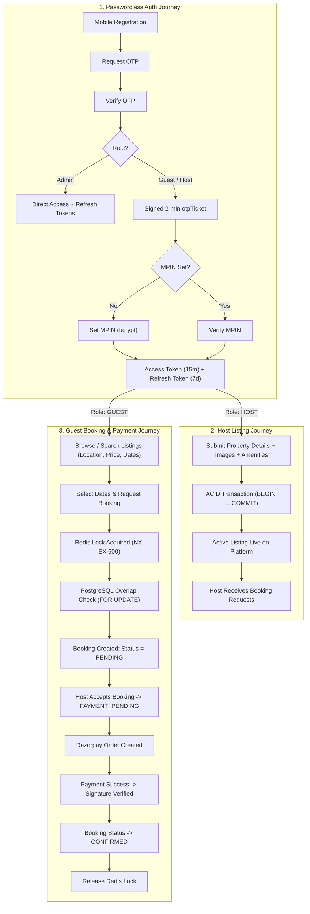
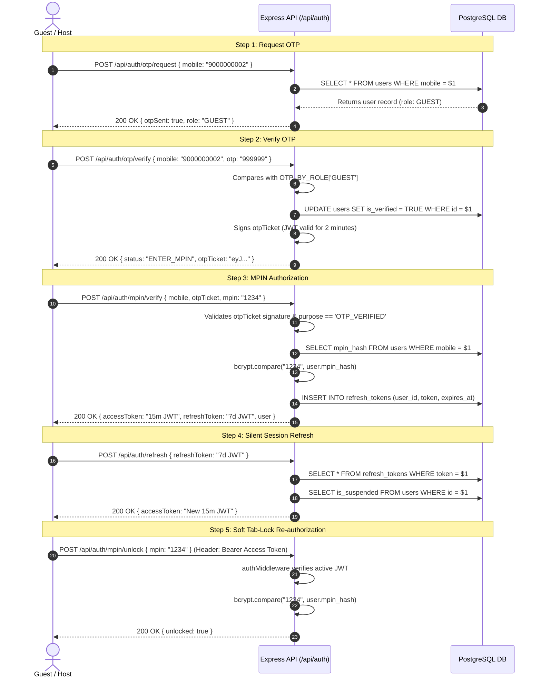
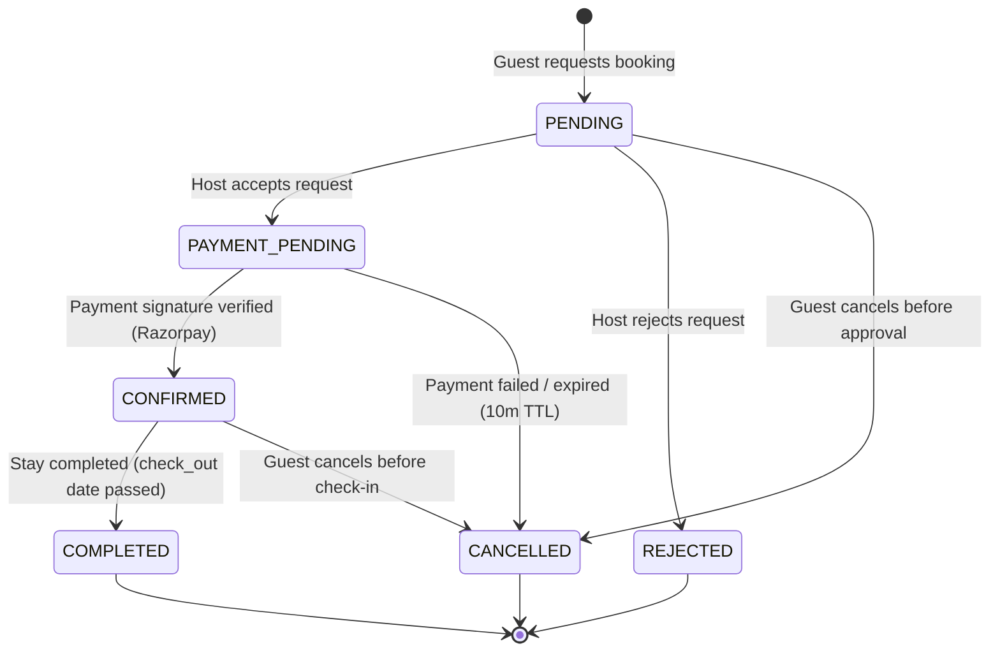
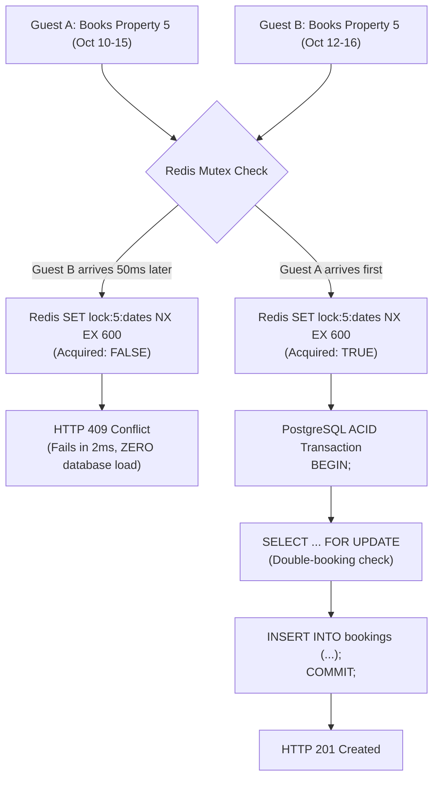
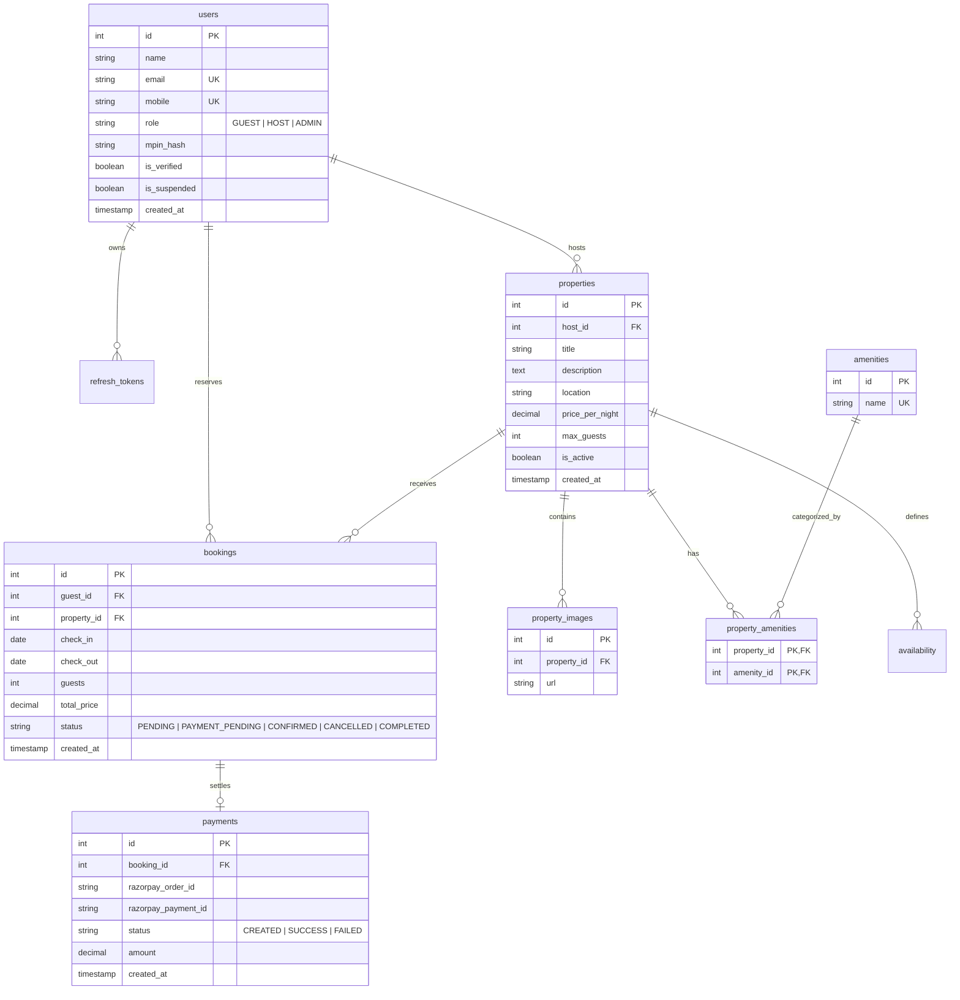

# Vistora — Complete System Flow, Code Architecture & Interview Guide

> **Document Scope:** Full Functional and Code-Wise Architecture for Vistora (Backend: `VistoraServer`)  
> **Target Audience:** Omkar Swami (Node.js Full-Stack Developer Interview Preparation)  
> **Tech Stack:** Node.js, Express, PostgreSQL (`pg`), Redis, Zod, bcrypt, JWT, Razorpay Sandbox  

---

## Table of Contents
1. [System Overview & Current Status](#1-system-overview--current-status)
2. [Functional Flow (End-to-End User Journeys)](#2-functional-flow-end-to-end-user-journeys)
   - [2.1 Authentication & Identity Flow (OTP + MPIN)](#21-authentication--identity-flow-otp--mpin)
   - [2.2 Host Property Listing Journey](#22-host-property-listing-journey)
   - [2.3 Guest Search & Browsing Journey](#23-guest-search--browsing-journey)
   - [2.4 Guest Booking Reservation Journey](#24-guest-booking-reservation-journey)
   - [2.5 Payment & Confirmation Journey](#25-payment--confirmation-journey)
   - [2.6 Admin Moderation Journey](#26-admin-moderation-journey)
3. [The Booking State Machine](#3-the-booking-state-machine)
4. [Concurrency Control: Redis Lock vs SQL Transaction](#4-concurrency-control-redis-lock-vs-sql-transaction)
5. [Code-Wise Architecture: The 5-Layer Pattern](#5-code-wise-architecture-the-5-layer-pattern)
   - [5.1 The 5 Architectural Layers](#51-the-5-architectural-layers)
   - [5.2 Complete Request Lifecycle Trace (`POST /api/properties`)](#52-complete-request-lifecycle-trace-post-apiproperties)
6. [Database Schema & Advanced SQL Engine](#6-database-schema--advanced-sql-engine)
   - [6.1 Entity-Relationship Diagram](#61-entity-relationship-diagram)
   - [6.2 Advanced SQL Patterns Used in Vistora](#62-advanced-sql-patterns-used-in-vistora)
7. [10 Killer Spoken Answers for the Interview](#7-10-killer-spoken-answers-for-the-interview)
8. [Backend Completion Blueprint (Next Steps)](#8-backend-completion-blueprint-next-steps)

---

# 1. System Overview & Current Status

Vistora is a production-grade property rental and booking platform engineered to prove deep Node.js backend capabilities:
- **Zero ORM:** Raw parameterized SQL queries using PostgreSQL (`pg` pool) for full control over transactions and performance.
- **Custom Passwordless Auth:** Phone-number identity + OTP verification + 4-digit MPIN hashing.
- **ACID Transactions:** Multi-table writes (Properties + Images + Amenities) committed atomically.
- **Concurrency Control:** Two-tier mutual exclusion (Redis TTL distributed locks + PostgreSQL row-level locks).
- **Strict Layering:** Routes $\to$ Zod Validation Middleware $\to$ Controllers $\to$ Services $\to$ Repositories.

### Implementation Checklist

| Phase / Feature | Status | Primary Code Files | Notes |
|---|:---:|---|---|
| **Phase 1: Database Setup** | **DONE** | [`src/server.js`](file:///O:/projects/VistoraServer/src/server.js), [`src/config/db.js`](file:///O:/projects/VistoraServer/src/config/db.js) | Aiven Cloud PostgreSQL connection pool with SSL handling |
| **Phase 2: Auth (OTP + MPIN)** | **DONE** | [`src/modules/auth/`](file:///O:/projects/VistoraServer/src/modules/auth/) | Register, OTP dispatch, 2-min `otpTicket`, MPIN set/verify, 15-m JWT access, 7-d DB refresh token, tab-lock unlock |
| **Phase 3: Property Management** | **DONE** | [`src/modules/properties/`](file:///O:/projects/VistoraServer/src/modules/properties/) | Create property via ACID transaction, `UNNEST` images, CTE amenities, get by ID via `JSON_AGG`, host listings |
| **Phase 4: Search & Filters** | ⏳ **NEXT** | `src/modules/properties/` | Dynamic SQL builder for `location`, `price_range`, `guests`, `check_in/out` availability |
| **Phase 5: Booking Core + State Machine** | ⏳ **NEXT** | `src/modules/bookings/` | Migration for `bookings` table, date overlap query (`FOR UPDATE`), status state machine |
| **Phase 6: Redis Concurrency Locks** | ⏳ **NEXT** | `src/config/redis.js`, `src/modules/bookings/` | Redis key mutex (`SET ... NX EX 600`) to block double-booking race conditions |
| **Phase 7: Razorpay Sandbox Payments** | ⏳ **NEXT** | `src/modules/payments/` | Order creation, HMAC-SHA256 signature verification, booking transition to `CONFIRMED` |

---

# 2. Functional Flow (End-to-End User Journeys)



---

## 2.1 Authentication & Identity Flow (OTP + MPIN)

Unlike traditional platforms using emails and passwords, Vistora uses a **fintech-inspired phone identity model**.



### Key Security Guardrails
1. **The 2-Minute `otpTicket`:** An attacker cannot jump straight to `/api/auth/mpin/verify` to brute-force a 4-digit PIN. The endpoint requires a cryptographically signed ticket proving the client verified the OTP within the last 120 seconds.
2. **Dual-Token Lifetime:**
   - **Access Token:** Lives for **15 minutes**. Sent in `Authorization: Bearer <token>`.
   - **Refresh Token:** Lives for **7 days**. Stored server-side in `refresh_tokens` so it can be revoked instantly on logout or account suspension.
3. **Soft Tab-Lock:** When a user switches tabs, the browser Page Visibility API activates a lock overlay. Calling `POST /api/auth/mpin/unlock` re-validates the MPIN using the active access token **without regenerating session tokens**, keeping pending network operations uninterrupted.

---

## 2.2 Host Property Listing Journey

```
Host Logs In (Role: HOST)
   │
   ▼
Submits Listing Form:
- Title, Description, Location, Price per Night, Max Guests
- Image URLs Array: ["https://...1.jpg", "https://...2.jpg"]
- Amenity IDs Array: [1, 3, 5]
   │
   ▼
[POST /api/properties]
   ├── 1. auth.middleware: Verifies token & active status
   ├── 2. role.middleware: Restricts to ['HOST']
   ├── 3. validate.middleware: Zod validates data types & bounds
   └── 4. Atomic PostgreSQL Transaction:
          BEGIN;
          INSERT INTO properties (...) RETURNING id;
          INSERT INTO property_images (property_id, url) SELECT $1, UNNEST($2::text[]);
          WITH inserted AS (
            INSERT INTO property_amenities (property_id, amenity_id)
            SELECT $1, UNNEST($2::int[])
            ON CONFLICT (property_id, amenity_id) DO NOTHING
          ) SELECT a.id, a.name FROM amenities a ... WHERE pa.property_id = $1;
          COMMIT;
   │
   ▼
Listing Live! Host can view under GET /api/properties/my-properties
```

---

## 2.3 Guest Search & Browsing Journey

1. **Public Catalog (`GET /api/properties`)**:
   - Guests can browse all active properties without logging in.
   - Database queries use safe pagination (`limit`, `offset`) to prevent memory exhaustion.
2. **Search & Filters (`GET /api/properties?location=Goa&min_price=2000&max_price=8000&guests=2`)**:
   - Location matches using case-insensitive partial search: `WHERE location ILIKE $1`.
   - Price range checks: `AND price_per_night BETWEEN $2 AND $3`.
   - Capacity checks: `AND max_guests >= $4`.
3. **Detailed View (`GET /api/properties/:id`)**:
   - Fetches property metadata, host contact details, and aggregated arrays of images and amenities in a single SQL query using `JSON_AGG(DISTINCT ...)`.

---

## 2.4 Guest Booking Reservation Journey

1. **Date Selection**: Guest chooses check-in and check-out dates along with guest count.
2. **Concurrency Check Tier 1 (Redis)**:
   - System attempts to set a distributed mutex in Redis with a 10-minute TTL.
   - If key already exists, returns `409 Conflict` (*"Dates are temporarily held by another guest"*).
3. **Concurrency Check Tier 2 (PostgreSQL Transaction)**:
   - Queries `bookings` table with `FOR UPDATE` to ensure no conflicting booking exists for the same dates in `CONFIRMED` or `PAYMENT_PENDING` status.
4. **Booking Insertion**:
   - Creates booking record with initial status: **`PENDING`**.
5. **Host Acceptance**:
   - Host reviews request and accepts: booking transitions from **`PENDING`** $\to$ **`PAYMENT_PENDING`**.

---

## 2.5 Payment & Confirmation Journey

1. **Razorpay Order Creation (`POST /api/payments/create-order`)**:
   - Backend calls Razorpay API to generate an order ID with amount in paise (`total_price * 100`).
2. **Checkout Modal**:
   - Frontend opens Razorpay test checkout modal.
3. **Signature Verification (`POST /api/payments/verify`)**:
   - Backend computes HMAC-SHA256 signature:
     $$\text{expectedSignature} = \text{HMAC-SHA256}(\text{order\_id} + "|" + \text{payment\_id}, \text{RAZORPAY\_SECRET})$$
   - If valid:
     - Payment record marked as `SUCCESS`.
     - Booking status transitions to **`CONFIRMED`**.
     - Redis lock is released.
   - If payment fails or times out:
     - Booking transitions to **`CANCELLED`**.
     - Redis lock is released.

---

## 2.6 Admin Moderation Journey

- **Direct Login**: Admin mobile `9000000000` + OTP `55555` directly issues session tokens without requiring an MPIN.
- **User Suspension**: Admin can toggle `is_suspended = true` on any bad actor.
  > [!IMPORTANT]
  > Because `authMiddleware` queries PostgreSQL (`findUserById`) on every single authenticated request, suspended users are blocked **in real time**, without waiting for their 15-minute access token to expire.
- **Listing Deactivation**: Admin can set `is_active = false` on properties violating platform terms.

---

# 3. The Booking State Machine

Booking state transitions must be strictly managed to prevent invalid business operations (e.g., paying for an already cancelled booking).



### State Machine Implementation Rule (`booking.statemachine.js`)

```javascript
const ALLOWED_TRANSITIONS = {
  PENDING: ['PAYMENT_PENDING', 'REJECTED', 'CANCELLED'],
  PAYMENT_PENDING: ['CONFIRMED', 'CANCELLED'],
  CONFIRMED: ['COMPLETED', 'CANCELLED'],
  COMPLETED: [],
  CANCELLED: [],
  REJECTED: [],
};

function canTransition(currentStatus, nextStatus) {
  const allowedNext = ALLOWED_TRANSITIONS[currentStatus] || [];
  return allowedNext.includes(nextStatus);
}
```

---

# 4. Concurrency Control: Redis Lock vs SQL Transaction

A classic interview question is: *"Why do you use both Redis and SQL transactions? Isn't one enough?"*



### The "Why Both?" Defense:
1. **Redis Distributed Mutex (`Tier 1 - Speed & Protection`):**
   - Executed via `SET lock:property:{id}:{checkIn}_{checkOut} guestId NX EX 600`.
   - Protects the database from heavy concurrent lock contention. If 1,000 users try to book the same room on Diwali, 999 are rejected in **~2 milliseconds** in memory without hammering PostgreSQL.
2. **PostgreSQL Row-Locking Transaction (`Tier 2 - Source of Truth`):**
   - Executed via `SELECT id FROM bookings WHERE ... FOR UPDATE`.
   - Guarantees 100% ACID consistency even if the Redis server crashes or restarts.

---

# 5. Code-Wise Architecture: The 5-Layer Pattern

Vistora enforces a strict **Unidirectional Dependency Flow**:

```
[HTTP Request]
       │
       ▼
[1. Route Layer]          *.routes.js        (URL matching & middleware chaining)
       │
       ▼
[2. Validation Layer]     validate.middleware.js + Zod schemas (Input sanitization)
       │
       ▼
[3. Controller Layer]     *.controller.js    (HTTP protocol adapter, status codes)
       │
       ▼
[4. Service Layer]        *.service.js       (Domain business rules, cryptography)
       │
       ▼
[5. Repository Layer]     *.repository.js    (Raw SQL queries, $1 placeholders)
       │
       ▼
[PostgreSQL Database]     Aiven Cloud PostgreSQL Pool
```

---

## 5.1 The 5 Architectural Layers

| Layer | Primary Role | Rules & Constraints |
|---|---|---|
| **1. Routes** | URL mapping & pipeline setup | Must chain in order: `auth` $\to$ `role` $\to$ `validate` $\to$ `controller`. Never contains logic. |
| **2. Validation** | Request body vetting | Uses Zod `.strict()`. Rejects invalid inputs before any database or business logic executes. |
| **3. Controller** | HTTP Translation | Extracts params (`req.body`, `req.params`, `req.user`), calls Service, sends HTTP status (`200`, `201`), passes errors to `next(error)`. |
| **4. Service** | Business Domain | Owns business rules, bcrypt hashing, JWT issuance. Throws operational `AppError`. Never touches Express `req` or `res`. |
| **5. Repository** | Data Access | Parameterized SQL queries (`$1, $2`). Manages PostgreSQL transactions (`BEGIN`, `COMMIT`, `ROLLBACK`). |

---

## 5.2 Complete Request Lifecycle Trace (`POST /api/properties`)

Here is how a real request flows through the physical code:

```
Step 1: Client Request
POST http://localhost:5000/api/properties
Headers: { "Authorization": "Bearer <JWT>" }
Body: { "title": "Beach Villa", "location": "Goa", "price_per_night": 5000, "max_guests": 4, "images": [...], "amenity_ids": [1, 2] }
   │
   ▼
Step 2: Route Match (src/modules/properties/property.routes.js)
router.post('/', authMiddleware, requireRole(['HOST']), validate(createPropertySchema), propertyController.createProperty);
   │
   ▼
Step 3: authMiddleware (src/middleware/auth.middleware.js)
1. Checks Authorization header starts with 'Bearer '.
2. Verifies token with jwt.verify().
3. Looks up user in DB: findUserById(decoded.userId).
4. Verifies user.is_suspended === false.
5. Populates req.user = { id: 7, role: 'HOST', ... }.
   │
   ▼
Step 4: roleMiddleware (src/middleware/role.middleware.js)
Checks requireRole(['HOST']). Since req.user.role === 'HOST', calls next().
   │
   ▼
Step 5: validateMiddleware (src/middleware/validate.middleware.js)
Runs createPropertySchema.safeParse(req.body). Sanitizes and types data.
   │
   ▼
Step 6: Controller (src/modules/properties/property.controller.js)
Calls propertyService.createProperty(req.user.id, req.body).
   │
   ▼
Step 7: Service (src/modules/properties/property.service.js)
Extracts images and amenityIds; prepares clean propertyData object.
Calls propertyRepository.createPropertyWithDetails(propertyData, images, amenityIds).
   │
   ▼
Step 8: Repository (src/modules/properties/property.repository.js)
1. const client = await pool.connect();
2. await client.query('BEGIN');
3. INSERT INTO properties (...) RETURNING *;
4. INSERT INTO property_images (property_id, url) SELECT $1, UNNEST($2::text[]);
5. WITH inserted AS (
     INSERT INTO property_amenities (property_id, amenity_id)
     SELECT $1, UNNEST($2::int[]) ON CONFLICT DO NOTHING
   ) SELECT a.id, a.name FROM amenities a JOIN property_amenities pa ON pa.amenity_id = a.id ...;
6. await client.query('COMMIT');
7. client.release();
   │
   ▼
Step 9: HTTP Response
Controller returns HTTP 201 Created:
{ "message": "Property created successfully", "property": { "id": 15, "title": "Beach Villa", ... } }
```

---

# 6. Database Schema & Advanced SQL Engine

## 6.1 Entity-Relationship Diagram



---

## 6.2 Advanced SQL Patterns Used in Vistora

### 1. `JSON_AGG` & `DISTINCT` (Preventing the Cartesian Product Fan-Out)
When querying a property with its photos and amenities, a basic `LEFT JOIN` creates a multiplication of rows: 5 photos $\times$ 4 amenities = 20 duplicated property rows.

Vistora eliminates this by having PostgreSQL aggregate relations directly into JSON arrays:
```sql
SELECT
  p.*,
  u.name AS host_name,
  COALESCE(
    JSON_AGG(DISTINCT JSONB_BUILD_OBJECT('id', pi.id, 'url', pi.url))
    FILTER (WHERE pi.id IS NOT NULL), '[]'
  ) AS images,
  COALESCE(
    JSON_AGG(DISTINCT JSONB_BUILD_OBJECT('id', a.id, 'name', a.name))
    FILTER (WHERE a.id IS NOT NULL), '[]'
  ) AS amenities
FROM properties p
JOIN users u ON p.host_id = u.id
LEFT JOIN property_images pi ON p.id = pi.property_id
LEFT JOIN property_amenities pa ON p.id = pa.property_id
LEFT JOIN amenities a ON pa.amenity_id = a.id
WHERE p.id = $1
GROUP BY p.id, u.id;
```

### 2. Bulk Insert with `UNNEST`
Instead of running a loop of multiple `INSERT` queries for images, a single parameterized array is expanded inside PostgreSQL:
```sql
INSERT INTO property_images (property_id, url)
SELECT $1, UNNEST($2::text[])
RETURNING id, url;
```

### 3. Date Overlap Formula
To check if two date ranges $(A_{\text{start}}, A_{\text{end}})$ and $(B_{\text{start}}, B_{\text{end}})$ overlap, the SQL condition is:
```sql
SELECT id FROM bookings
WHERE property_id = $1
  AND status IN ('CONFIRMED', 'PAYMENT_PENDING')
  AND NOT (check_out <= $2 OR check_in >= $3)
FOR UPDATE;
```
> [!TIP]
> The condition `NOT (check_out <= $2 OR check_in >= $3)` accurately detects partial overlaps, total overlaps, and enclosing date ranges.

---

# 7. 10 Killer Spoken Answers for the Interview

Practice these 30-40 second answers out loud:

### Q1: "Why raw SQL instead of Prisma or TypeORM?"
> *"I chose raw SQL with the `pg` library to have complete control over query performance, database-level locking, and connection pooling. ORMs often abstract away transactions and produce inefficient subqueries or N+1 query problems when fetching nested relations like images and amenities. With raw SQL, I wrote clean parameterized queries to prevent SQL injection, used PostgreSQL's `JSON_AGG` to serialize relational data directly in the database engine in a single round-trip, and wrote explicit ACID transactions with `BEGIN`, `COMMIT`, and `ROLLBACK`."*

### Q2: "Why OTP + MPIN instead of standard email and password?"
> *"Rental platforms require strong mobile identity because hosts and guests communicate directly via phone and WhatsApp. Passwords create credential-stuffing vulnerabilities and password-reset friction. OTP verifies phone ownership, while a 4-digit MPIN gives users a fast daily unlock like modern fintech apps."*

### Q3: "What is the purpose of the 2-minute signed `otpTicket`?"
> *"The `otpTicket` is a short-lived cryptographic JWT bridging OTP verification and MPIN verification. Without this ticket, an attacker could bypass OTP verification entirely and call `/api/auth/mpin/verify` or `/mpin/set` directly. The ticket contains `{ userId, mobile, purpose: 'OTP_VERIFIED' }`, ensuring that only a client that just verified the OTP can touch the MPIN endpoints."*

### Q4: "How do you handle double-booking race conditions?"
> *"I implemented a two-tier concurrency control strategy:  
> 1. Fast mutual exclusion in Redis using `SET lock:property:{id}:{dates} {guestId} NX EX 600`, which rejects concurrent requests in ~2ms without loading the database.  
> 2. A database-level source of truth using a PostgreSQL ACID transaction with `SELECT ... FOR UPDATE` and a date overlap condition to prevent overlapping reservations at the data layer."*

### Q5: "How does your soft MPIN tab-lock work between frontend and backend?"
> *"The frontend listens to the HTML5 Page Visibility API. When a user navigates away and returns, Pinia sets `isLocked = true` and renders an MPIN overlay. The user enters their MPIN, which calls `POST /api/auth/mpin/unlock` using their active access token. The backend verifies the MPIN hash and returns `{ unlocked: true }` without regenerating tokens, keeping existing session state and pending requests intact."*

### Q6: "How do you block suspended users in real time with stateless JWTs?"
> *"Purely stateless JWTs cannot invalidate a user until the token expires. To fix this, our `authMiddleware` queries PostgreSQL using `findUserById(decoded.userId)` on every authenticated request. If `user.is_suspended` is true, it immediately aborts with an HTTP 403 Forbidden response, revoking access in real time."*

### Q7: "Why did you use `JSON_AGG` and `DISTINCT` in the property module?"
> *"In `findPropertyById`, joining `property_images` and `property_amenities` simultaneously causes a Cartesian product fan-out. 5 images and 4 amenities produce 20 rows. Using `JSON_AGG(DISTINCT JSONB_BUILD_OBJECT(...))` deduplicates entries and returns images and amenities as structured JSON arrays directly from PostgreSQL in a single network round-trip."*

### Q8: "How does silent session refresh work on 401 errors?"
> *"When the 15-minute access token expires, the Axios interceptor catches the 401 response. It places subsequent outgoing requests into a promise queue (`failedQueue`), sends the refresh token to `POST /api/auth/refresh`, updates the stored access token, and then replays all queued requests seamlessly."*

### Q9: "Why do you store refresh tokens in the database if they are signed JWTs?"
> *"Signing a JWT only guarantees integrity, not revocability. By persisting refresh tokens in the `refresh_tokens` table, we can immediately revoke sessions upon user logout, password reset, or admin suspension by deleting the token record from the database."*

### Q10: "How does your 5-layer architecture make the codebase maintainable?"
> *"Each layer has a single responsibility: Routes define endpoints and middleware chains; Zod validates schemas before logic runs; Controllers handle HTTP status codes; Services contain domain logic and cryptography; and Repositories execute raw SQL. Each module exposes a single `index.js`, making modules pluggable black boxes."*

---

# 8. Backend Completion Blueprint (Next Steps)

To complete the backend and make it 100% demo-ready for your interview:

```
[Phase 4: Search & Filters]
  └── Dynamic SQL query builder in property.repository.js (ILIKE, price BETWEEN, guests >=)

[Phase 5: Booking Core + State Machine]
  ├── Database migration: bookings table (PostgreSQL)
  ├── booking.statemachine.js: Transition validator
  ├── booking.repository.js: Overlap query with FOR UPDATE
  └── booking.service.js & booking.controller.js: Booking lifecycle endpoints

[Phase 6: Redis Concurrency Locking]
  ├── config/redis.js: ioredis client
  └── Redis lock acquisition and release helpers in booking creation flow

[Phase 7: Razorpay Sandbox Payments]
  ├── Database migration: payments table
  ├── Razorpay order creation endpoint
  └── Signature verification endpoint (HMAC-SHA256) -> status: CONFIRMED
```

---
*Created for Omkar Swami — Vistora Backend Master Architecture & Interview Preparation.*
